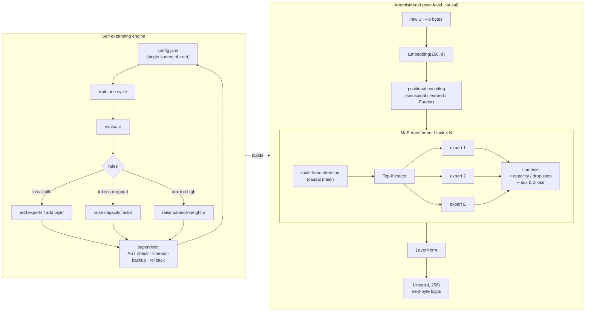

# Artemis 567885

**A CPU-first Top-K sparse Mixture-of-Experts transformer in PyTorch that grows itself: a supervised engine adds experts, layers and capacity when training stalls, and rolls back when a change breaks.**


Built by Latoya Pittman at Cutline Industries as the research core of Artemis AI.
Every number below was measured and is linked to the branch, commit or log it came from.

---

## What it is

| Part | What it does | Where |
|---|---|---|
| **Sparse MoE layer** | Top-K router, per-expert capacity, auxiliary load-balancing loss, dropped-token accounting. Loop and vectorized dispatch, parity-tested. | `moe.py` (this branch); fixes in [#1](https://github.com/lpittman-blip/artemis-567885/pull/1) |
| **MoE transformer block** | Multi-head attention plus the MoE feed-forward, stacked into a multi-block model with optional causal mask and positional encodings. | `transformer.py`, `model.py` ([#2](https://github.com/lpittman-blip/artemis-567885/pull/2), [#7](https://github.com/lpittman-blip/artemis-567885/pull/7)) |
| **Self-expanding engine** | Trains in cycles. When loss stalls it adds experts or a layer; when tokens are dropped it raises the capacity factor; `config.json` is the single source of truth. Hard caps on every knob. | `expand.py` ([#2](https://github.com/lpittman-blip/artemis-567885/pull/2), branch `expand-loop`) |
| **Self-fixing supervisor** | Runs each cycle in a subprocess with a timeout, AST-checks generated changes, keeps backups, auto-corrects shape mismatches against the checkpoint and rolls back on failure. | `supervisor.py` ([#2](https://github.com/lpittman-blip/artemis-567885/pull/2)) |
| **ArtemisModel (byte LM)** | Tokenizer-free: raw UTF-8 bytes → `Embedding(256, d)` → causal MoE blocks → 256-way next-byte softmax. | `model.py`, `train_bytes.py` ([#9](https://github.com/lpittman-blip/artemis-567885/pull/9), [#10](https://github.com/lpittman-blip/artemis-567885/pull/10)) |
| **Routing research** | Causal-safe per-sequence capacity, Switch-style gate weighting, router z-loss, expert-choice routing, noisy routing. | [#11](https://github.com/lpittman-blip/artemis-567885/pull/11), [#12](https://github.com/lpittman-blip/artemis-567885/pull/12), [#14](https://github.com/lpittman-blip/artemis-567885/pull/14) |
| **Physics sandbox** | A SIREN-MoE physics-informed network used as a second, non-language test bed for routing. | `physics_simulation.py` ([#14](https://github.com/lpittman-blip/artemis-567885/pull/14)) |
| **Fourier features + web byte streaming** | Multiscale Fourier position features, and polite HTTP Range streaming of real text with cache, rate limit and resumable offsets. | `fourier.py`, `webstream.py` ([#15](https://github.com/lpittman-blip/artemis-567885/pull/15), [#16](https://github.com/lpittman-blip/artemis-567885/pull/16)) |
| **Dense rebuild** | A dense (no-MoE) Artemis transformer with BPE or byte tokenizer, staged pretrain + assistant-only SFT and a held-out bits-per-byte report. | branch `dense-model`, `artemis_dense/` |

`main` holds the original 4-file baseline. The work is a stack of reviewed pull requests, one stage each, so every change can be read on its own.

## Architecture



## Measured results

All CPU unless noted. Exact commands, seeds and raw logs are in `PROGRESS.md` and `runs/` on the linked branches.

| Experiment | Result | Source |
|---|---|---|
| Self-expanding engine, 105 supervised cycles (synthetic sin(x) regression) | eval loss **0.0965 → 0.0260**; grew from 1 layer × 4 experts to **12 layers / 87 experts**; capacity factor 0.8 → 2.5 (cap). One cycle timed out under CPU contention and **rolled back cleanly**, then passed. | branch `expand-loop` @ `3bc5e10`, `config.json` history, `runs/expand_log.jsonl` |
| Byte-level LM on Project Gutenberg (5.4M params, 900 s, 8 CPU threads) | held-out **1.761 bits/byte** vs 4.581 unigram baseline (validation authors never seen in training); test split 1.975 vs 4.708 | [#10](https://github.com/lpittman-blip/artemis-567885/pull/10), branch `stage-6-byte-training` @ `28877c7` |
| Physics sandbox, noisy routing (stage 8b) | relative L2 error at t=1: **0.0077** vs baseline 0.2497; all 4 experts used (baseline collapsed to 2) | [#14](https://github.com/lpittman-blip/artemis-567885/pull/14), `docs/STAGE8B_PHYSICS.md`, `runs/stage8b/` |
| Switch gate weighting | task-only gate gradient 0.000000 → 0.015389 (fixes a dead-gradient bug in top-1 renormalisation) | [#12](https://github.com/lpittman-blip/artemis-567885/pull/12), `tools/stage8_gate_grad.py` |
| Loop vs vectorized dispatch (18 configs, parity-gated) | vectorized 1.99–2.97× faster at E=64, d=64 with 8 threads; slower for forward+backward at d=256, so `loop` stays the default | [#8](https://github.com/lpittman-blip/artemis-567885/pull/8), `benchmarks/README.md` |
| Web byte streaming smoke test | HTTP 206 range reads verified against an independent `curl` sha256; ≥ 1.0 s between requests; cache hits make no request | [#16](https://github.com/lpittman-blip/artemis-567885/pull/16), `docs/STAGE9B_WEBSTREAM.md`, `runs/stage9b/` |
| Dense rebuild, GPU run 1 (48.8M params, 1× RTX A6000, 50 min, 374M tokens) | held-out web text **3.293 → 1.191 bits/byte**; Artemis docs **4.036 → 1.374** ("before" = untrained init). Rented GPU, hard cost cap, destroyed after; measured spend $0.44. | branch `dense-model`; run log not committed yet |
| Test suite (stage 9b) | 376 passed, 1 xfailed (`python3 -m pytest -q tests checks`) | [#16](https://github.com/lpittman-blip/artemis-567885/pull/16), `PROGRESS.md` iteration 9 |

Negative results are kept too: the original physics pilot did not converge, and the expand engine plateaued around 0.025–0.028 once it hit its caps. See `PLAN.md`.

## Quickstart

The baseline on `main` needs only Python 3 and PyTorch (the CPU build is enough):

```bash
git clone https://github.com/lpittman-blip/artemis-567885.git
cd artemis-567885
python3 -m pip install torch
python3 sandbox.py
```

`sandbox.py` builds one `MoETransformerBlock` (d_model 16, 2 heads, 4 experts, top-2, capacity factor 0.8), runs a forward and backward pass with seed 42, and prints the loss, the dropped-token count and two gradient norms. With torch 2.14.1+cpu the recorded output was Total Loss 1.5083, 6 dropped, ∇x 0.1581, ∇W_g 0.0546 (`PROGRESS.md`, iteration 1). Other torch versions may differ slightly.

To try the full model and the expansion engine, check out the newest stage:

```bash
git checkout stage-9c-byte-clf            # or expand-loop for the engine's latest state
python3 -m pip install torch pytest
python3 sandbox.py --mode legacy          # reproduces the baseline numbers
python3 -m pytest -q tests checks         # full suite (a few minutes on CPU)
python3 train_bytes.py --help             # byte-level training options
```

`train_bytes.py` expects a local text corpus (`bytelm/build_corpus.py` builds the Gutenberg one; corpus text is not committed) or `--text FILE`.

## Roadmap

- [x] Fix the baseline MoE (aux loss, capacity priority, dropped tokens) behind a `legacy` flag
- [x] Self-expanding engine + self-fixing supervisor
- [x] Byte-level causal MoE language model with held-out bits-per-byte
- [x] Causal-safe capacity, Switch weighting, z-loss, expert-choice and noisy routing
- [x] Fourier features and polite web byte streaming
- [ ] Stage 9(c): byte-level continuous-language-field prototype (bytes + Fourier document position → causal MoE), with a no-position ablation
- [ ] Fixed-architecture control run to separate "growth" from "more training"
- [ ] Multi-seed reruns where results differ by ~0.01 bits/byte
- [ ] GPU training of the MoE byte model and a public eval report

## Contributing

Issues and pull requests are welcome. See [CONTRIBUTING.md](CONTRIBUTING.md). The house rule is simple: **numbers need a command, a seed and a log**, and estimates are labelled as estimates.

## License

No license has been chosen yet, so all rights are reserved for now. A license will be added before outside contributions are merged.
