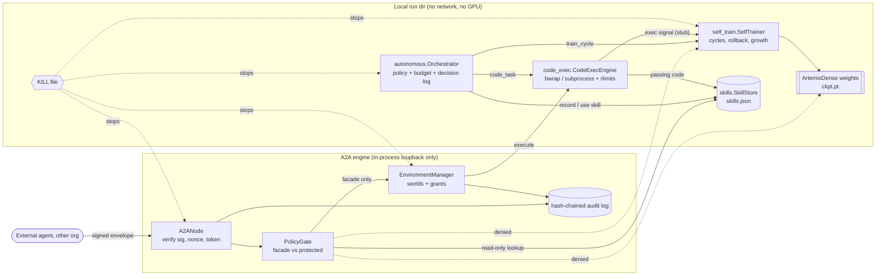

# artemis_dense — Artemis 567885 as one dense transformer

Local-only rebuild (branch `dense-model`, not pushed). No training runs, no GPU, no server.

## Model (`config.py`, `model.py`)
Decoder-only dense transformer: byte vocab (256), pre-norm RMSNorm, causal multi-head attention
with RoPE (grouped-query optional via `n_kv_heads`), one SwiGLU feed-forward network per block,
tied embeddings, no biases. Default: 8 layers, d_model 256, 8 heads, d_ff 768, context 256 =
**6,885,632 parameters**, every one active for every token. `forward(tokens, targets)` returns
`(logits, loss)`; `forward_vectors(x)` returns `(y, 0, 0)` like the old MoE model's 3-tuple.
Growth is function-preserving: `add_layer()` (zero-init `wo` and `w_down`) and `widen_ffn(n)`
(new `w_down` columns are zero).

## The engines (`engines/`)
| engine | file | role | agent doc |
|---|---|---|---|
| self-training | `self_train.py` | cycles: train → eval → checkpoint or roll back → grow within caps | [self_train.agent.md](engines/self_train.agent.md) |
| skills | `skills.py` | JSON registry of reusable procedures with success scores | [skills.agent.md](engines/skills.agent.md) |
| code execution | `code_exec.py` | write → run → observe → revise in a sandbox | [code_exec.agent.md](engines/code_exec.agent.md) |
| autonomous | `autonomous.py` | picks the next action from a policy, logs every decision, bounded | [autonomous.agent.md](engines/autonomous.agent.md) |
| A2A | `a2a/` | signed cross-org handshakes, policy gate, environments ("worlds") | [a2a/agent.md](engines/a2a/agent.md) |

How they connect: the **autonomous** orchestrator is the only thing that drives the others. Each
step it reads state (trainer history, skill scores, queued code tasks) and chooses one whitelisted
action. `train_cycle` calls the **self-training** engine, which trains, evaluates, checkpoints or
rolls back, and plans growth within caps. After clean cycles the orchestrator records the
procedure in the **skills** store and later reuses it, which updates its score. `code_task` hands
a task to **code_exec**, which loops a proposer (the model, or a scripted stand-in) through a
sandbox. A passing solution is saved as a `code` skill, and every outcome is appended to the
trainer's `exec_signal.jsonl` (a stub hook: nothing trains on it yet). The **A2A** engine faces
outward. External agents see only a facade (echo, text stats, read-only skill lookup, and
environment operations under signed grants). Environment `execute` goes through code_exec's
sandbox. The trainer, the skill writes and the weights are never reachable from outside.

## Code-exec sandbox: enforced vs best-effort
- Always enforced: separate process and session; wall-clock timeout then SIGKILL of the process
  group; `setrlimit` on CPU seconds, address space, file size, open files and core files; an env
  built from scratch (PATH/HOME/TMPDIR/LANG plus two PYTHON flags, nothing inherited, so no
  `VAST_API_KEY`, tokens or proxies); `python -I -S`; a fresh temp dir under `<run_dir>/exec/`;
  output capped (16 KB default).
- Enforced when bubblewrap is usable (it is on this box: `/usr/bin/bwrap`): `--unshare-all`
  (separate network namespace, so no network), and a filesystem view of read-only `/usr` plus the
  task dir at `/work` and private `/tmp`, `/proc` and `/dev`. Home, `/workspace`, `~/.ssh`,
  checkpoints and run dirs are not visible.
- Best-effort fallback (no bwrap): `socket` functions are monkey-patched to raise before user code
  runs. Code could bypass that through `_socket` or ctypes. Filesystem confinement is only "cwd is
  the temp dir". Absolute paths stay readable under normal Unix permissions.
- Not covered: CPU and memory cgroups; seccomp syscall filtering; GPU isolation (none is used).

## Kill switch
Create a file named `KILL` in a run dir or any parent of it (`killswitch.engage(dir)`). The
trainer (before and during every step), the orchestrator (each step), the A2A node (each request)
and the environment manager (each operation) stop. Code-exec children are bounded by their timeout.

## Docs
[GOVERNANCE.md](GOVERNANCE.md) · [skills.md](skills.md) · [worlds.md](worlds.md) ·
[HTTP_HTTPS.md](HTTP_HTTPS.md) · [NFC.md](NFC.md) · [RadioBand.md](RadioBand.md) ·
[UltraWideband.md](UltraWideband.md) · [A2A architecture](engines/a2a/docs/ARCHITECTURE.md) ·
[A2A prototype spec](engines/a2a/docs/PROTOTYPE_SPEC.md)

## Tests (CPU only, seconds)
`tests/test_dense_model.py`, `tests/test_dense_engines.py`, `tests/test_a2a.py`.
