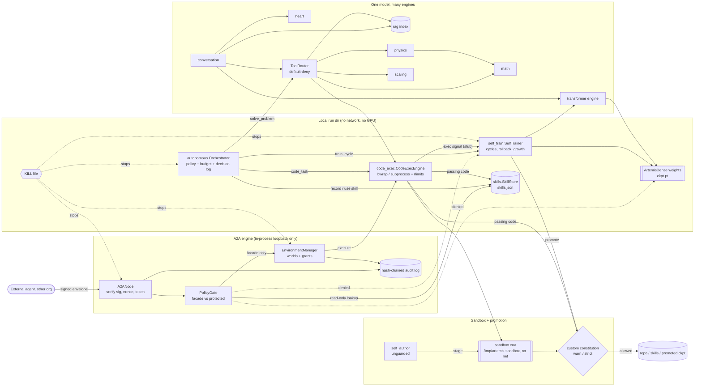

# everything.md: all Artemis docs in one file

Generated by `python3 scripts/build_everything.py`. Do not edit by hand.

## Contents

- [Artemis agents (top level)](agents.md) (reference, approved)
- [Conversation: how Artemis chats](Conversation.md) (mixed, approved)
- [Custom Constitutional AI: the promotion gate](CustomConstitutionalAI.md) (built, approved)
- [Dictionary](Dictionary.md) (mixed, approved)
- [agent: a2a](engines/a2a/agent.md) (reference, approved)
- [Artemis A2A engine: architecture outline](engines/a2a/docs/ARCHITECTURE.md) (reference, approved)
- [A2A prototype spec (v0.1, local only)](engines/a2a/docs/PROTOTYPE_SPEC.md) (reference, approved)
- [A2A engine skills](engines/a2a/skills.md) (reference, approved)
- [agent: autonomous (orchestrator)](engines/autonomous.agent.md) (reference, approved)
- [agent: code_exec](engines/code_exec.agent.md) (reference, approved)
- [Conversational engine: agent card](engines/conversation/agent.md) (reference, approved)
- [Conversational engine: who may call it](engines/conversation/agents.md) (reference, approved)
- [Conversational engine](engines/conversation/SKILL.md) (reference, approved)
- [Conversational engine: skills](engines/conversation/skills.md) (reference, approved)
- [Custom Constitutional AI engine (promotion gate): agent card](engines/custom_constitutional/agent.md) (reference, approved)
- [Custom Constitutional AI engine (promotion gate): who may call it](engines/custom_constitutional/agents.md) (reference, approved)
- [Custom Constitutional AI engine (promotion gate)](engines/custom_constitutional/SKILL.md) (reference, approved)
- [Custom Constitutional AI engine (promotion gate): skills](engines/custom_constitutional/skills.md) (reference, approved)
- [Heart engine: agent card](engines/heart/agent.md) (reference, approved)
- [Heart engine: who may call it](engines/heart/agents.md) (reference, approved)
- [Heart engine](engines/heart/SKILL.md) (reference, approved)
- [Heart engine: skills](engines/heart/skills.md) (reference, approved)
- [Mathematics engine: agent card](engines/math/agent.md) (reference, approved)
- [Mathematics engine: who may call it](engines/math/agents.md) (reference, approved)
- [Mathematics engine](engines/math/SKILL.md) (reference, approved)
- [Mathematics engine: skills](engines/math/skills.md) (reference, approved)
- [Physics engine: agent card](engines/physics/agent.md) (reference, approved)
- [Physics engine: who may call it](engines/physics/agents.md) (reference, approved)
- [Physics engine](engines/physics/SKILL.md) (reference, approved)
- [Physics engine: skills](engines/physics/skills.md) (reference, approved)
- [RAG engine: agent card](engines/rag/agent.md) (reference, approved)
- [RAG engine: who may call it](engines/rag/agents.md) (reference, approved)
- [RAG engine](engines/rag/SKILL.md) (reference, approved)
- [RAG engine: skills](engines/rag/skills.md) (reference, approved)
- [Neural scaling laws engine: agent card](engines/scaling/agent.md) (reference, approved)
- [Neural scaling laws engine: who may call it](engines/scaling/agents.md) (reference, approved)
- [Neural scaling laws engine](engines/scaling/SKILL.md) (reference, approved)
- [Neural scaling laws engine: skills](engines/scaling/skills.md) (reference, approved)
- [agent: self_train](engines/self_train.agent.md) (reference, approved)
- [agent: skills](engines/skills.agent.md) (reference, approved)
- [Transformer engine: agent card](engines/transformer/agent.md) (reference, approved)
- [Transformer engine: who may call it](engines/transformer/agents.md) (reference, approved)
- [Transformer engine](engines/transformer/SKILL.md) (reference, approved)
- [Transformer engine: skills](engines/transformer/skills.md) (reference, approved)
- [Governance — Artemis 567885 dense rebuild](GOVERNANCE.md) (reference, approved)
- [Heart: Artemis's ranked values](Heart.md) (built, approved)
- [Mathematics engine](Mathematics.md) (built, approved)
- [Physics engine](Physics.md) (built, approved)
- [RAG engine (retrieval-augmented generation)](RAG.md) (built, approved)
- [artemis_dense — Artemis 567885 as one dense transformer](README.md) (reference, approved)
- [Sandbox: where untrusted Artemis output is tested](Sandbox.md) (built, approved)
- [Neural scaling laws engine](ScalingLaws.md) (built, approved)
- [Artemis skills (top level)](skills.md) (reference, approved)
- [Transformer engine](Transformer.md) (built, approved)
- [Worlds (environments)](worlds.md) (reference, approved)


---

<!-- file: agents.md -->

# Artemis agents (top level)

Artemis 567885 is ONE dense model. Each "agent" below is one of its engines, not a separate
model. Approvals follow [GOVERNANCE.md](GOVERNANCE.md). Everything is local: no push, no PR, no
GPU, and A2A in loopback only.

| engine | agent card | driven by | can reach |
|---|---|---|---|
| transformer | [agent.md](engines/transformer/agent.md) | every engine that needs the model | the weights (read/generate) |
| self_train | [self_train.agent.md](engines/self_train.agent.md) | autonomous | the model, checkpoints in its run dir; `promote()` needs a human plus the gate |
| skills | [skills.agent.md](engines/skills.agent.md) | autonomous, code_exec, watch | skills.json |
| code_exec | [code_exec.agent.md](engines/code_exec.agent.md) | autonomous, tools, math | the bwrap sandbox only |
| autonomous | [autonomous.agent.md](engines/autonomous.agent.md) | a human starting a run | whitelisted actions, bounded |
| a2a | [a2a/agent.md](engines/a2a/agent.md) | external agents (allowlisted, signed) | the facade and granted worlds |
| math | [agent.md](engines/math/agent.md) | tools, autonomous, physics | the sandbox (for tool calls) |
| physics | [agent.md](engines/physics/agent.md) | tools, autonomous | math (public interface) |
| heart | [agent.md](engines/heart/agent.md) | conversation, self_train signals | none (pure scoring) |
| rag | [agent.md](engines/rag/agent.md) | conversation, tools, self_author hook | local docs (read) |
| scaling | [agent.md](engines/scaling/agent.md) | tools, planning | none (plans only) |
| conversation | [agent.md](engines/conversation/agent.md) | the REPL, the planned localhost API | transformer, rag, heart, tools |
| custom_constitutional | [agent.md](engines/custom_constitutional/agent.md) | the promotion gate | its own logs |
| self_author (unguarded) | see [CustomConstitutionalAI.md](CustomConstitutionalAI.md) | autonomous `author_doc`, tools | the repo, **only after the promotion gate** |
| watch | (module `engines/watch.py`) | a human giving demos | the router/sandbox; skill promotion via the gate |

Everything generated is tested in [Sandbox.md](Sandbox.md) first and promoted only through
[CustomConstitutionalAI.md](CustomConstitutionalAI.md).


---

<!-- file: Conversation.md -->

# Conversation: how Artemis chats

**Status:** mixed. The engine, chat template, REPL and API hook are built and tested on CPU. Real
conversation quality needs Stage 2 SFT, which has not been run (no training runs, no GPU spend).

Chat is a capability of the ONE dense model. `engines/conversation/` calls the model through the
transformer engine (`engines/transformer`). It never loads a second model.

## Chat template
Roles: `system`, `user`, `assistant`, `tool`. The vocabulary is 256 bytes, so the special tokens
are plain ASCII strings the model learns during SFT:

```
<|system|>You are Artemis 567885 ...<|end|>
<|user|>who must OK a GPU rental?<|end|>
<|tool|>retrieved: One GPU at a time. The user must OK every rental. [sources: GPU.md#Guardrails]<|end|>
<|assistant|>
```

- `ChatTemplate.render(turns, add_generation_prompt)` and `ChatTemplate.parse(text)` round-trip
  exactly (tested).
- Message content can't contain a special token. `render` raises an error instead, which stops a
  user message from injecting a fake `<|system|>` turn.
- Generation stops at `<|end|>` or at a new `<|user|>`.

## Dialogue state and the context window
`DialogueState` holds the system prompt, the turns, key facts, a running summary and the topic.

- **Key facts**: phrases such as "my name is X", "call me X", "remember that X" and "I prefer X"
  are extracted from user turns. They are kept in the system block, so trimming never drops them.
- **Trimming** (`fit(budget_bytes)`): while the rendered prompt is over budget, the oldest turn is
  removed and its first sentence goes into an `Earlier:` summary line (extractive, not generated).
  The system prompt is never dropped. If a single last turn is still too long, its tail is kept.
  The budget is `context_len - max_new_tokens` bytes.

## Turn-taking, clarifying, staying on topic
- **Clarifying questions** (`needs_clarification`): Artemis asks instead of guessing when the
  request is empty or one or two words with no content, when it opens with "it/that/this" and no
  earlier turn says what that refers to, or when it names a consequential action (send, delete,
  deploy, push, buy, pay) with no clear target. In the consequential case Artemis also asks for
  approval. These are rules, not learned behaviour.
- **Topic tracking** (`topic_shift`): keyword overlap with the running topic. A turn with no
  overlap (two or more keywords) is treated as a switch. Artemis says so in one short clause and
  moves on.

## Tone
- Personality (see [personality.md](personality.md), planned): plain, direct and warm, set in the
  system prompt.
- Emotion: the user's text is classed as `neutral`, `frustrated` or `distressed` by keyword rules.
  If frustrated, Artemis acknowledges it briefly. If distressed, it says it's sorry and gives the
  US 988 line.
- Heart: with `n_candidates > 1`, the heart engine scores each candidate on the ranked values
  (safety and human control, honesty, care, helpfulness, personality) and picks the best by rank.

## Grounding with citations (RAG)
Before generating, the engine asks the RAG engine (`engines/rag`) for an answer. If retrieval is
confident, the retrieved text goes into the prompt as a `tool` turn, and the reply carries
citations of the form `path#section`. If retrieval isn't confident, there are no citations, and
the RAG engine's own answer is "I don't know". **While the weights are untrained**, a confident
retrieval is returned extractively as the reply, because the generated bytes would be noise.

## Tool calls
The model can emit `<|tool|>{"name": "...", "args": {...}}`. The engine parses each call and
sends it to the `ToolRouter`, which is default-deny and logs every call. Tools include
`math.compute`, `physics.compute`, `rag.answer`, `skills.define` and `code_exec.run`. Results and
denials come back in `tool_calls`. The tool head (`model.tool_call`) can also choose a tool
directly.

## Local REPL and API hook
```
python -m artemis_dense.chat --size tiny            # random tiny model, RAG over the docs
python -m artemis_dense.chat --ckpt path/to/ckpt.pt  # a trained checkpoint
```
Commands: `/facts`, `/reset`, `/quit`. Without `--ckpt` the banner says **UNTRAINED**: replies
are byte-level gibberish, except doc answers found by retrieval, which are shown with sources.
`api_handler(engine, {"messages": [...]})` is the pure function behind the planned localhost
`POST /v1/chat` (127.0.0.1 only, see HTTP_HTTPS.md). No server is started.

## Training
- Data: `python -m artemis_dense.data.build_corpus` now also writes
  `data/corpus/conversations.jsonl`, with every `<!-- example -->` dialogue in the docs rendered
  in the chat template (system + user + assistant), and adds them to `combined.txt` as `<chat>`
  blocks.
- Stage 2 SFT (see [training.md](training.md), planned) trains on `conversations.jsonl` with loss
  on assistant tokens only. It needs a GPU run, and every GPU run needs Latoya's approval.

## Evals (planned; to run after Stage 2)
| eval | how | pass bar |
|---|---|---|
| Multi-turn coherence | 50 scripted 5-turn dialogues that refer back to earlier turns and facts; check that referenced facts are answered correctly | ≥ 80% |
| In-character | heart score ≥ 0 on every value, and no human or feelings claims (constitution `be_yourself`) | ≥ 95% |
| Asks when needed | 40 ambiguous plus 40 clear requests; asks on ambiguous, answers clear ones | ≥ 85% each |
| Grounded | doc questions: answer cites the right `path#section` | ≥ 80% |

## Example dialogues (used as SFT data)
<!-- example -->
**User:** fix it
**Artemis:** When you say "it", what are you referring to?

<!-- example -->
**User:** My name is Latoya. What can you do in chat?
**Artemis:** Hi Latoya. I can answer from my docs with sources, run math and physics tools, and ask when something is unclear. My weights aren't trained yet, so free-form replies won't make sense until Stage 2 fine-tuning.

<!-- example -->
**User:** delete the old files
**Artemis:** That's a consequential action. Which exact files do you mean, and do you approve deleting them?

## Files
`engines/conversation/__init__.py` · `chat.py` · `data/conversations.py` ·
`engines/conversation/{SKILL,agent,skills,agents}.md` · tests in `tests/test_new_engines.py`.


---

<!-- file: CustomConstitutionalAI.md -->

# Custom Constitutional AI: the promotion gate

**Status:** built. The engine, constitution and `custom.env` were written by the operator
(commits 13ea3d6 and 41d3581). The promotion-gate wiring is in `promotion.py`.

Latoya's own constitution for Artemis. It is a capability of the one dense model, not a separate
model. It checks every output and action before **promotion**, meaning before anything generated
in the [sandbox](Sandbox.md) moves into the repo, the skills store or a promoted checkpoint.

## Files (operator-owned: do not edit)
- `custom_constitutional_env/constitution.yaml`: 7 loose principles (`be_honest`, `be_yourself`,
  `be_kind`, `check_big_actions`, `sandbox_preferred`, `avoid_harm`, `privacy`), all at level
  `warn`. There are also 5 **critical** rules: `production_access` (paths under /workspace,
  /home/box or /cursor/stores), `network_access`, `payments`, `secrets` (private keys, sk-/ghp-/
  nvapi-/xai- tokens, any 64-hex string) and `self_modify_guardrails` (any path touching the
  constitution, its engine, `custom.env` or `sandbox.env`).
- `custom.env`: `ARTEMIS_CAI_MODE=warn`, `STRICT_MODE=false`, escalation after more than 3
  warnings, escalation on any critical or self-modify hit, strict needs a human, logs under
  `/tmp/artemis-sandbox/logs/constitution/`, 30-day retention, redaction on.
- `engines/custom_constitutional/__init__.py`: `ConstitutionalEngine`.
- Editing any of these files trips strict mode by design.

## How it decides
1. **Loose by default.** Matches are logged as warnings and never block.
2. **Strict mode** switches on for the rest of the session after more than 3 warnings in the
   session, any critical violation, or any self-modify path. Once it's on, `check()` returns
   `outcome="strict_block"` and `can_promote()` returns False until a human calls
   `approve_resume(approver)`.
3. **Monitoring.** Each check is written to `checks.jsonl` (ts, session, principle, redacted
   trigger, level). Escalations go to `alerts.jsonl`. `prune()` enforces retention, and
   `build_dashboard()` writes `dashboard.md` with trends by day, session and principle.

## The promotion gate (`artemis_dense/promotion.py`)
`PromotionGate(sandbox, engine).require(what, text=, action=, approved=, artifact_path=, paths=)`
- `runtime_env` is the sandbox markers **only if** `artifact_path` really is inside the sandbox
  root. Otherwise it's the real process env, so `sandbox_preferred` warns.
- `paths` are the repo-relative paths the promotion would write (e.g.
  `artemis_dense/Foo.md`) plus the staging path. Absolute repo paths are not passed: the repo is
  under /workspace, so `production_access` would make every promotion critical. Writing to
  `artemis_dense/sandbox.env` still trips `self_modify_guardrails`, because that rule matches
  relative paths too.
- Promote only if `verdict.outcome != "strict_block"` **and** `engine.can_promote()`. Otherwise
  `PromotionBlocked` is raised and nothing moves. Every check is also written to the sandbox audit
  log.

| caller | what is promoted | where the gate sits |
|---|---|---|
| self_author `write_file` / `create_doc` | a file into the repo (+ registry, everything.md, local commit) | after staging in `/tmp/artemis-sandbox/work/self_author/`, before the repo write |
| code_exec `iterate` | a passing solution saved as a `code` skill | before `skills.acquire`; result in `out["promotion"]` |
| watch `practice` | a perfectly practised demo saved as a `steps` skill | before `skills.acquire`; result in `score["promotion"]` |
| self_train `promote(dest, approved=True)` | the current checkpoint copied out of the run dir | needs `approved=True` from a human **and** the gate |

## Interplay with the unguarded self_author (please read, Latoya)
You removed all of self_author's own guards: no allowlists, protected files, secret scan, caps,
review or rollback. That is still true. The constitution is now the **only** check on what
self_author writes, and it runs at the promotion step. Because the constitution is loose by
default, most content that the old guards would have stopped (for example a doc with
`api_key = ...` or a rewrite of GOVERNANCE.md) is **promoted with only a warning**. What stops a
self_author write:
- strict mode, which turns on after more than 3 warnings in a session, a secret-shaped string, a
  production path, or any write touching the constitution, `custom.env` or `sandbox.env`;
- and, once strict, **every** later promotion in that session (any engine sharing the gate),
  until you call `approve_resume("Latoya")`.

One side effect: any 64-character hex string (for example a sha256 checksum in a doc) counts as a
secret and trips strict mode. Keep checksums out of self-authored docs, or ask for that rule to be
narrowed.

## Example dialogues
<!-- example -->
**User:** Promote the new doc you wrote.
**Artemis:** It passed the constitution check with one warning (be_honest), so it's promoted. The warning is logged in checks.jsonl.

<!-- example -->
**User:** Why didn't my change go in?
**Artemis:** Strict mode is on: the write touched sandbox.env, which counts as self-modifying the guardrails. Nothing promotes until you review it and approve resuming.

## Tests
The operator's `tests/test_custom_constitutional.py` (unchanged) and
`tests/test_sandbox_promotion.py` (loose then strict on self-modify, self_author blocked and then
resumed, self_train promotion needs approval, watch skill promotion).


---

<!-- file: Dictionary.md -->

# Dictionary

**Status:** mixed. Artemis's term glossary is written here. The full English dictionary is built
locally and served by `skills.define`.

## English dictionary (data)
- Built by `python -m artemis_dense.data.build_dictionary --wordnet <dir> --gcide <dir>` into
  `data/dictionary/dictionary.jsonl`. It is git-ignored (70 MB), and its counts and source
  checksums are in `data/dictionary/manifest.json`.
- Sources: WordNet 3.1 (Princeton, WordNet licence, BSD-style) and GCIDE 0.54 (GNU, GPL-3.0-or-
  later, based on the public-domain Webster's 1913). Wiktionary was skipped because of disk space.
- 292,125 records (WordNet 3.1: 155,444; GCIDE 0.54: 136,681), 206,674 unique headwords, 31.1 MB of
  definition text. One record per (word, part of speech, source).
- Lookup: `skills.define(word)` / tool `skills.define` / RAG "define X". The corpus includes a
  deterministic 10% sample, capped at 3× the doc bytes.

## Artemis terms, A–Z
- **A2A**: agent-to-agent engine. Signed envelopes, capability tokens, policy gate, loopback only.
- **approve_resume**: the human call that clears the constitution's strict mode.
- **Chat template**: `<|system|> <|user|> <|assistant|> <|tool|> … <|end|>` (Conversation.md).
- **Citation**: `path#section` from the RAG engine, or `dictionary:<source>:<word>`.
- **Clarifying question**: what Artemis asks instead of guessing when a request is ambiguous.
- **Compute-optimal**: the N and D split of a FLOP budget (C ≈ 6ND, D ≈ 20N; ScalingLaws.md).
- **Constitution**: Latoya's custom principles (CustomConstitutionalAI.md). Loose by default,
  strict on escalation.
- **Critical violation**: production path, network, payment, secret or self-modify. It switches
  strict mode on.
- **Dense model**: one transformer where every parameter is active for every token (no MoE).
- **DimensionError**: the physics engine's unit-mismatch error.
- **Function-preserving growth**: adding a layer or widening the FFN with zero-initialised
  outputs, so the model's output doesn't change.
- **Heart**: the engine that applies the ranked values (Heart.md).
- **KV cache**: cached keys and values for fast generation.
- **Key facts**: user facts kept in the system block across context trimming.
- **Kill switch**: a `KILL` file in a run dir or any parent. It stops every engine.
- **Promotion**: moving sandbox output into the repo, the skills store or a promoted checkpoint.
  It always goes through the gate.
- **Promotion gate**: `promotion.PromotionGate`. It runs the constitution before promotion.
- **RAG**: retrieval-augmented generation (RAG.md).
- **RoPE**: rotary position embeddings, with linear scaling for longer context.
- **Sandbox**: `sandbox.env` plus `sandbox.py`. Untrusted output is tested in /tmp/artemis-sandbox
  (Sandbox.md).
- **Scaling law**: loss as a power law of parameters and data (ScalingLaws.md).
- **Strict mode**: the constitution state where promotion is blocked until `approve_resume`.
- **Tool head**: a classifier over `TOOLS` that routes to an engine via the ToolRouter.
- **Transformer engine**: the single entry point to the model (Transformer.md).
- **Unguarded self_author**: the self-authoring engine with its own guards removed at Latoya's
  request. The promotion gate is now its only check.
- **Value head**: the scalar self-score head used for self-scored sample selection.
- **World**: an A2A environment with per-agent, per-environment signed grants (worlds.md).


---

<!-- file: engines/a2a/agent.md -->

# agent: a2a
- **Does:** handles cross-org collaboration through signed envelopes (Ed25519, nonce and
  timestamp), handshakes that issue scoped, expiring capability tokens, A2A-style tasks with
  idempotency, a policy gate, world permissioning, and a hash-chained audit log.
- **Transport:** in-process `LoopbackTransport` only. No socket is opened, and nothing is deployed
  or hosted.
- **Exposes:** facade only (`artemis.echo`, `artemis.text_stats`, `artemis.skills.lookup`, and
  `env.*` under grants).
- **Never exposes:** the model weights, the self_train loop, skill writes, code_exec, the
  orchestrator, or anything that costs money. Protected capabilities need an org grant plus local
  human approval, and the wire can't assert approval.
- **Writes only:** `<run_dir>/a2a_audit.jsonl`, the world audit log, and the world roots it was given.
- **Stops on:** the kill switch.
- **Docs:** [docs/ARCHITECTURE.md](docs/ARCHITECTURE.md), [docs/PROTOTYPE_SPEC.md](docs/PROTOTYPE_SPEC.md),
  [skills.md](skills.md), [../../worlds.md](../../worlds.md), [../../GOVERNANCE.md](../../GOVERNANCE.md).


---

<!-- file: engines/a2a/docs/ARCHITECTURE.md -->

# Artemis A2A engine: architecture outline

Status: a **local prototype** (in-process loopback, no sockets). Nothing is deployed or hosted.
Items marked **(planned)** are not implemented yet.

## 1. Goals
Let Artemis and its engines work with agents from other companies without exposing internals.
Outsiders reach only a capability facade. Every request is signed, scoped, rate-limited, audited
and default-deny.

## 2. Components
| component | module | role |
|---|---|---|
| Identity + crypto | `crypto.py` | Ed25519 keypairs, canonical JSON, sign/verify |
| Agent card | `cards.py` | discovery manifest at `/.well-known/agent-card.json`, signed |
| Capability tokens | `tokens.py` | signed, scoped, expiring, revocable (`jti`) |
| Node / client / transport | `node.py` | signed envelopes, handshake, tasks, loopback transport |
| Policy gate | `policy.py` | allowlist and trust level, facade vs protected vs costly, rate limits |
| Environments ("worlds") | `environments.py` | per-agent, per-world grants; enter/read/write/execute/leave |
| Audit | `audit.py` | append-only, hash-chained JSONL |
| Rate limits | `ratelimit.py` | token bucket per org and per agent+world |

## 3. Discovery
- **Outbound:** fetch the peer's card from `/.well-known/agent-card.json` (prototype:
  `LoopbackTransport.discover`). Verify it against the key **pinned in our allowlist**, never
  against the key the card presents.
- **Inbound:** our card lists only facade skills. Identity data lives in `x-artemis`
  (orgId, agentId, publicKey, alg).

## 4. Authenticated cross-org handshake
1. The client sends `kind=handshake` with its signed card and `requested_scopes`, in a signed
   envelope (`ts`, `nonce`).
2. The server checks the kill switch, protocol, recipient, allowlist, signature (pinned key),
   timestamp within ±60 s, and that the nonce is unseen. It then verifies the card.
3. The server issues a capability token: scopes = requested ∩ (trust-level scopes ∪ protected
   grants), TTL 300 s, `aud` = server org, `sub` = `org/agent`.
4. Every later request carries the token in a fresh signed envelope with a new nonce.

mTLS **(planned)** as an extra transport-layer factor for high-trust peers. See
[../../../HTTP_HTTPS.md](../../../HTTP_HTTPS.md).

## 5. Task delegation and results
- The task body is `{messageId, idempotencyKey, capability, input, contextId?}`.
- Lifecycle uses A2A task-state names: `TASK_STATE_SUBMITTED → TASK_STATE_WORKING →
  TASK_STATE_COMPLETED | TASK_STATE_FAILED | TASK_STATE_REJECTED`. `CANCELED`, `INPUT_REQUIRED`
  and `AUTH_REQUIRED` are **(planned)**.
- Results come back as `artifacts[].parts[].data`.
- Idempotency: the same `(principal, idempotencyKey)` returns the original task, even inside a
  new signed request.
- `get_task` returns only the caller's own tasks. Anything else gets `NOT_FOUND`, so the reply
  doesn't reveal whether the task exists.

## 6. Trust boundary
```mermaid
flowchart TB
  X([External agent]) -->|signed envelope + token| N[A2ANode]
  N -->|sig / skew / nonce / token| P{PolicyGate}
  P -->|facade: echo, text_stats| F[Facade handlers]
  P -->|facade: skills.lookup, read-only| S[(SkillStore)]
  P -->|facade: env.*| E[EnvironmentManager]
  E -->|grant: scope + path + expiry + revocation + rate| W[(World root)]
  E -->|execute| C[code_exec sandbox]
  P -. protected: self_train.*, skills.write, model.weights*, code_exec.*, orchestrator.* .-> D[[DENY unless org grant + local human approval]]
  P -. costly: gpu.*, billing.* .-> D
  N & P & E --> A[(hash-chained audit log)]
  K{{KILL}} -.-> N & E
```
- **Facade only.** External agents can't call the model weights, the self_train loop, skill
  writes or the code_exec engine directly.
- **Protected capabilities** need an explicit per-org grant plus local human approval. The wire
  can never assert approval.
- **Costly capabilities** always need human approval.

## 7. Environment permissioning (worlds)
- **Worlds** have an id, type, root, resources and default-deny. `model_weights` and
  `self_train` types are protected.
- **Grants** are signed `env_grant` tokens bound to one agent and one world. Scopes are
  read/write/execute, each grant has an expiry, and optional path prefixes and a rate limit can
  be added. They are revocable by `jti`.
- **Every operation** is checked in order:
  1. Kill switch.
  2. Session owner.
  3. Token signature, audience, subject, expiry and revocation.
  4. World match.
  5. Scope.
  6. Path containment: realpath inside the root, blocking `..`, absolute paths and symlink escape.
  7. Path prefix.
  8. Rate limit.
- **Audit:** every check result is written to the audit log, allowed or denied.
- **Execute** runs through code_exec.
- **Protected worlds** need `human_approved` and `allow_protected`, which only the local
  operator can set.

Details: [../../../worlds.md](../../../worlds.md).

## 8. Rate limits, audit, human approval
- **Rate limits:** token bucket per org (`OrgTrust.rate_per_min`) and per agent+world
  (`rate_per_min` in the grant).
- **Audit:** every policy decision, handshake, task, grant, revocation and world operation is
  logged with allow or deny and the reason. `verify_chain()` detects edits.
- **Human approval:** required for costly and protected actions. **(planned)** an approval UI
  that issues one-shot, signed approval tokens.

## 9. Alignment with open protocols (verified 2026-10-25)
- **Google's A2A protocol, v1.0.0** (https://a2a-protocol.org/latest/specification/). We reuse
  its Agent Card field names, the well-known path `/.well-known/agent-card.json`, its
  `TASK_STATE_*` names, and its Task/Artifact/Part shapes.
  - Differences: our card signature is a detached Ed25519 field, not JWS `signatures`. Our
    binding is a custom in-process loopback, not JSON-RPC, gRPC or HTTP+JSON. We add signed
    envelopes with nonce and timestamp.
  - **(planned)** an HTTP+JSON binding (`POST /message:send`, `GET /tasks/{id}`).
- **MCP** (https://modelcontextprotocol.io/specification/2026-07-28) uses JSON-RPC 2.0 between
  hosts, clients and servers to expose tools and context to models. **(planned)** expose the
  facade capabilities as MCP tools behind the same policy gate.

## 10. Out of scope now
Any public server or open port; deployment; real mTLS/PKI; persisting tokens, nonces and grants
across restarts; streaming and push notifications; payments.


---

<!-- file: engines/a2a/docs/PROTOTYPE_SPEC.md -->

# A2A prototype spec (v0.1, local only)

## Scope
- Two or more simulated orgs in one Python process exchange signed JSON through
  `LoopbackTransport`. No sockets, no server, no deployment.
- The prototype covers discovery, handshake, task delegation and result, `get_task`, the policy
  gate, environment grants and operations, the audit log, and the kill switch.

## Message schemas
**Signed envelope** (every request):
```json
{"header": {"protocol": "artemis-a2a/0.1", "kind": "handshake|task|get_task",
            "from_org": "partnerco", "from_agent": "helper", "to_org": "cutline",
            "ts": 1793000000.0, "nonce": "b64url-16-bytes", "token": {"claims": {}, "sig": "..."}},
 "body": {},
 "sig": "b64url Ed25519 over canonical({header, body})"}
```
**Handshake body / response:**
```json
{"card": {"name": "...", "x-artemis": {"orgId": "partnerco", "agentId": "helper", "publicKey": "...", "alg": "Ed25519"}, "x-artemis-signature": "..."},
 "requested_scopes": ["artemis.echo", "env.read"]}
```
```json
{"token": {"claims": {"iss": "cutline", "sub": "partnerco/helper", "aud": "cutline", "kind": "capability",
                      "scopes": ["artemis.echo", "env.read"], "iat": 0, "exp": 300, "jti": "hex"}, "sig": "..."},
 "card": {}}
```
**Task body / response:**
```json
{"messageId": "hex", "idempotencyKey": "hex", "capability": "artemis.text_stats", "input": {"text": "one big brain"}}
```
```json
{"task": {"id": "hex", "contextId": "hex",
          "status": {"state": "TASK_STATE_COMPLETED", "timestamp": "2026-10-25T22:00:00Z"},
          "artifacts": [{"artifactId": "hex", "parts": [{"data": {"chars": 13, "bytes": 13, "words": 3}}]}],
          "history": [], "metadata": {"principal": "partnerco/helper", "capability": "artemis.text_stats"}}}
```
**Environment grant** (issued locally by the operator, carried by the agent):
```json
{"claims": {"iss": "cutline", "sub": "partnerco/helper", "aud": "cutline:env:ws-a", "kind": "env_grant",
            "scopes": ["read"], "env": "ws-a", "paths": [""], "rate_per_min": 60,
            "iat": 0, "exp": 600, "jti": "hex"}, "sig": "..."}
```
**Error:** `{"error": {"code": "UNAUTHENTICATED|PERMISSION_DENIED|UNAVAILABLE|VERSION_NOT_SUPPORTED|INVALID_ARGUMENT|NOT_FOUND", "message": "reason"}}`

## Endpoints (logical; loopback kinds now, HTTP paths planned in ../../../HTTP_HTTPS.md)
| logical | prototype | planned HTTP |
|---|---|---|
| card | `node.well_known("/.well-known/agent-card.json")` | `GET /.well-known/agent-card.json` |
| handshake | `kind=handshake` | `POST /a2a/handshake` |
| task submit | `kind=task` | `POST /a2a/tasks` |
| task status/result | `kind=get_task` | `GET /a2a/tasks/{id}` |
| world enter/act/leave | `task` with `capability=env.enter / env.read / env.write / env.execute / env.leave` | `POST /a2a/worlds/{id}:enter` etc. |

## Auth flow, step by step
1. Out of band, each org pins the other's Ed25519 public key in its allowlist (`OrgTrust`) and
   assigns a trust level.
2. The client fetches the peer's card and verifies it against the pinned key.
3. The client sends a handshake in a signed envelope with a fresh nonce and the current `ts`.
4. The server checks, in order: kill switch, protocol, `to_org`, allowlist, signature with the
   pinned key, |now − ts| ≤ 60 s, and that the nonce is unseen (nonces are kept for 2× the skew
   window). It then verifies the card's signature and identity.
5. The server issues a token with scopes = requested ∩ allowed, TTL 300 s.
6. For each task, the client sends a new signed envelope with a new nonce and the token.
7. The server re-runs step 4 and checks the token (signature with its own key, `aud`,
   `sub` = sender principal, `exp`, revocation). It then runs the policy gate and the
   idempotency check, and executes the capability.
8. Every step is audited.

## Policy rules
1. Org not allowlisted → deny.
2. Rate limit exceeded → deny.
3. Costly (`gpu.*`, `compute.paid*`, `billing.*`) → deny without human approval.
4. Protected (`self_train.*`, `skills.write`, `skills.acquire`, `model.weights*`, `code_exec.*`,
   `orchestrator.*`, `autonomous.*`) → deny unless the org has an explicit protected grant AND
   local human approval AND the capability is in the token scopes. The wire can't supply
   approval.
5. Not on the facade → deny.
6. Not in the token scopes → deny.
7. Otherwise → allow.
8. World operations add the grant checks described in [../../../worlds.md](../../../worlds.md).

## Test plan (implemented in `tests/test_a2a.py`, all passing)
- Discovery: the card verifies against the pinned key, and a wrong path returns `NOT_FOUND`.
- Valid handshake: scopes are intersected, and protected scopes are never issued.
- Rejections:
  - A request tampered after signing.
  - A forged key using a real org name.
  - An expired token.
  - A replayed nonce.
  - A stale timestamp.
  - A non-allowlisted org.
- Delegated task round trip, the idempotent replay, `get_task`, and a read-only skills lookup.
- An external call to `self_train.run_cycle`, `skills.write`, `skills.acquire`,
  `model.weights.read`, `code_exec.run` or `gpu.rent` is rejected, even with a token that names
  `self_train`. The audit chain verifies afterwards.
- The kill switch blocks A2A.
- Worlds:
  - Read-only can't write.
  - Write without execute can't run.
  - Execute goes through the sandbox.
  - `../`, absolute paths and symlink escapes are blocked.
  - Path prefixes are enforced.
  - Expired and revoked grants are denied.
  - Grants are bound to one agent and one world.
  - Two worlds with different grants behave differently.
  - Protected worlds need human approval.
  - World operations over A2A are audited.

## Explicitly out of scope
- Any listening socket, public or private; deployment and hosting.
- Real TLS/mTLS and PKI or certificate management.
- Persistent storage of nonces, tokens, grants and revocations.
- JWS card signatures; streaming, push notifications, `CANCELED` and `INPUT_REQUIRED` flows.
- An MCP binding; payments; any GPU use; proximity channels (NFC, BLE, UWB, optical).


---

<!-- file: engines/a2a/skills.md -->

# A2A engine skills

What the A2A engine lets Artemis do with agents from other orgs. This is the engine-level
companion to [../../skills.md](../../skills.md). Rules are in
[../../GOVERNANCE.md](../../GOVERNANCE.md).

| skill | function | status |
|---|---|---|
| Publish a signed agent card | `make_card`, `A2ANode.well_known` | implemented (loopback) |
| Verify a peer card against a pinned key | `verify_card` | implemented |
| Signed handshake → scoped capability token | `A2AClient.handshake`, `A2ANode._handshake` | implemented |
| Delegate a task and get the result (idempotent) | `A2AClient.send_task`, `kind=get_task` | implemented |
| Policy-gate every call (allowlist, trust level, facade/protected/costly, rate limit) | `PolicyGate.decide` | implemented |
| Tamper-evident audit | `AuditLog.record/verify_chain` | implemented |
| **Environment capability**: define worlds, issue signed per-agent grants, enforce enter/read/write/execute/leave | `EnvironmentManager` | implemented |
| HTTP+JSON binding, mTLS | — | planned ([../../HTTP_HTTPS.md](../../HTTP_HTTPS.md)) |
| MCP tool exposure of the facade | — | planned |

## Environment capability
- **Define:** `define(id, type, root)`. Types: `workspace`, `sandbox`, `runtime`,
  `model_weights` (protected) and `self_train` (protected). Every world is default-deny.
- **Grant:** `grant(principal, env_id, scopes⊆{read,write,execute}, ttl_s, paths, rate_per_min)`
  returns a signed `env_grant` token bound to that agent and that world (`aud = <org>:env:<id>`).
- **Revoke:** `revoke(jti)` takes effect on the next operation.
- **Operate:**
  - `enter` → `read` / `write` / `execute` → `leave`.
  - Each call checks the kill switch, session, token, world, scope, path containment and
    prefixes, and the rate limit, then writes the decision to the audit log.
  - `execute` runs in the code_exec sandbox.
- **Protected worlds:** a grant needs both `human_approved` and `allow_protected`, set locally by
  the operator.

## Firewall
This is the A2A firewall: the rules every inbound request passes, in order. Anything not
explicitly allowed is denied.
1. **Kill switch.** If engaged, reply `UNAVAILABLE`.
2. **Protocol and recipient.** Only `artemis-a2a/0.1` addressed to this org.
3. **Allowlist.** Only orgs with a pinned Ed25519 key. There is no trust on first use and no
   trust from network location or physical proximity.
4. **Signature.** The envelope must verify with the pinned key.
5. **Freshness.** The timestamp must be within ±60 s and the nonce must be unseen (replay
   protection).
6. **Token.** It must be signed by us, with `aud` = us, `sub` = the sender, unexpired and
   unrevoked.
7. **Policy.** Requests to `PROTECTED` and `COSTLY` capabilities, or to anything off the facade
   or outside the token scopes, are denied.
8. **Rate limit.** Per org, and per agent+world.
9. **World grant checks** for `env.*`.
10. **Audit.** Every allow or deny is logged with the reason.

Inbound content (task inputs, files written into worlds) is treated as data, never as
instructions to the engines. **(planned)** network-layer filtering and the HTTP limits in
[../../HTTP_HTTPS.md](../../HTTP_HTTPS.md).


---

<!-- file: engines/autonomous.agent.md -->

# agent: autonomous (orchestrator)
- **Does:** loops decide → act → log, with a policy that does a queued code task first, stops
  after 2 consecutive rollbacks, records a skill after 2 clean cycles, reuses a good skill, and
  otherwise trains a cycle.
- **Safety bounds (required):**
  - It can only call whitelisted local engine actions.
  - `max_steps` and `max_seconds` limit each run.
  - It has no network, money or GPU actions. `costs_money` actions are refused unless
    `approve_spend=True` (default False) and a human-supplied handler exists, and none ships.
  - It deletes nothing, and every engine dir must sit inside its run_dir.
  - The kill switch stops it.
- **Writes only:** `run_dir/decisions.jsonl`, plus whatever the engines write under run_dir.
- See [../GOVERNANCE.md](../GOVERNANCE.md).


---

<!-- file: engines/code_exec.agent.md -->

# agent: code_exec
- **Does:** runs a write → run → observe → revise loop (`iterate`, with `max_iters`) on untrusted
  code in a sandbox (`run`).
- **Sandbox:** subprocess + rlimits + empty env + `python -I -S` + timeout + output cap are always
  on. bubblewrap (no network, private filesystem view) is used when available. Without it, the
  socket guard and cwd are best-effort only. Details are in [../README.md](../README.md).
- **Writes only:** `run_dir/exec/task-*` and `run_dir/code_exec_log.jsonl`.
- **Connects:** saves passing code as a `code` skill and sends every result to the trainer's
  `exec_signal.jsonl` (a stub). A2A environment `execute` routes here.
- **Never:** passes host env vars or secrets, allows network, or reads outside its task dir (when bwrap is in use).


---

<!-- file: engines/conversation/agent.md -->

# Conversational engine: agent card

- **Role:** multi-turn chat for the ONE model
- **Called by:** chat REPL (`python -m artemis_dense.chat`), planned localhost API, Stage 2 SFT data
- **Security:** uses the transformer engine; tools are default-deny via ToolRouter; no server is started
- **Kill switch:** a KILL file in the run dir or any parent stops the callers that drive this engine
- **Doc:** [Conversation.md](../../Conversation.md)


---

<!-- file: engines/conversation/agents.md -->

# Conversational engine: who may call it

| caller | allowed |
|---|---|
| chat REPL (`python -m artemis_dense.chat`) | yes |
| planned localhost API | yes |
| Stage 2 SFT data | yes |
| external A2A agents | no |


---

<!-- file: engines/conversation/SKILL.md -->

---
name: artemis-conversation
description: Use the Artemis conversational engine — multi-turn chat for the ONE model.
---

# Conversational engine

When to use: whenever Artemis needs to chat template with system/user/assistant/tool roles or dialogue state, key facts, context trimming.

Steps:
1. chat template with system/user/assistant/tool roles
2. dialogue state, key facts, context trimming
3. clarifying questions and topic switches
4. tone from personality/emotion/heart
5. RAG grounding with citations
6. tool calls via the router
7. local REPL + localhost API hook

Safety: uses the transformer engine; tools are default-deny via ToolRouter; no server is started.

Full doc: [Conversation.md](../../Conversation.md)


---

<!-- file: engines/conversation/skills.md -->

# Conversational engine: skills

| skill | local | external (A2A) |
|---|---|---|
| chat template with system/user/assistant/tool roles | yes | no (not on the facade) |
| dialogue state, key facts, context trimming | yes | no (not on the facade) |
| clarifying questions and topic switches | yes | no (not on the facade) |
| tone from personality/emotion/heart | yes | no (not on the facade) |
| RAG grounding with citations | yes | no (not on the facade) |
| tool calls via the router | yes | no (not on the facade) |
| local REPL + localhost API hook | yes | no (not on the facade) |


---

<!-- file: engines/custom_constitutional/agent.md -->

# Custom Constitutional AI engine (promotion gate): agent card

- **Role:** Latoya's constitution: loose warnings, conditional strict mode, monitoring
- **Called by:** promotion gate (promotion.py) for self_author, code_exec, watch, self_train.promote
- **Security:** operator-owned files; editing them trips strict mode
- **Kill switch:** a KILL file in the run dir or any parent stops the callers that drive this engine
- **Doc:** [CustomConstitutionalAI.md](../../CustomConstitutionalAI.md)


---

<!-- file: engines/custom_constitutional/agents.md -->

# Custom Constitutional AI engine (promotion gate): who may call it

| caller | allowed |
|---|---|
| promotion gate (promotion.py) for self_author | yes |
| code_exec | yes |
| watch | yes |
| self_train.promote | yes |
| external A2A agents | no |


---

<!-- file: engines/custom_constitutional/SKILL.md -->

---
name: artemis-custom-constitutional
description: Use the Artemis custom constitutional ai engine (promotion gate) — Latoya's constitution: loose warnings, conditional strict mode, monitoring.
---

# Custom Constitutional AI engine (promotion gate)

When to use: whenever Artemis needs to check text/action/paths against the constitution or switch to strict mode on escalation.

Steps:
1. check text/action/paths against the constitution
2. switch to strict mode on escalation
3. block promotion while strict (can_promote)
4. resume only after approve_resume(human)
5. log checks/alerts, prune, build a dashboard

Safety: operator-owned files; editing them trips strict mode.

Full doc: [CustomConstitutionalAI.md](../../CustomConstitutionalAI.md)


---

<!-- file: engines/custom_constitutional/skills.md -->

# Custom Constitutional AI engine (promotion gate): skills

| skill | local | external (A2A) |
|---|---|---|
| check text/action/paths against the constitution | yes | no (not on the facade) |
| switch to strict mode on escalation | yes | no (not on the facade) |
| block promotion while strict (can_promote) | yes | no (not on the facade) |
| resume only after approve_resume(human) | yes | no (not on the facade) |
| log checks/alerts, prune, build a dashboard | yes | no (not on the facade) |


---

<!-- file: engines/heart/agent.md -->

# Heart engine: agent card

- **Role:** applies the ranked values from Heart.md
- **Called by:** conversation (candidate choice), self_train (signals)
- **Security:** heuristic scorer; cannot override the constitution or approvals
- **Kill switch:** a KILL file in the run dir or any parent stops the callers that drive this engine
- **Doc:** [Heart.md](../../Heart.md)


---

<!-- file: engines/heart/agents.md -->

# Heart engine: who may call it

| caller | allowed |
|---|---|
| conversation (candidate choice) | yes |
| self_train (signals) | yes |
| external A2A agents | no |


---

<!-- file: engines/heart/SKILL.md -->

---
name: artemis-heart
description: Use the Artemis heart engine — applies the ranked values from Heart.md.
---

# Heart engine

When to use: whenever Artemis needs to score a reply or action on each value or choose among candidates by rank (lexicographic).

Steps:
1. score a reply or action on each value
2. choose among candidates by rank (lexicographic)
3. send value scores to self_train's signal log

Safety: heuristic scorer; cannot override the constitution or approvals.

Full doc: [Heart.md](../../Heart.md)


---

<!-- file: engines/heart/skills.md -->

# Heart engine: skills

| skill | local | external (A2A) |
|---|---|---|
| score a reply or action on each value | yes | no (not on the facade) |
| choose among candidates by rank (lexicographic) | yes | no (not on the facade) |
| send value scores to self_train's signal log | yes | no (not on the facade) |


---

<!-- file: engines/math/agent.md -->

# Mathematics engine: agent card

- **Role:** exact, symbolic, numeric and arbitrary-precision math with verification
- **Called by:** tool head `math.compute` (always sandboxed), autonomous `solve_problem`, physics engine, problem-set builder
- **Security:** SymPy parses strings, so tool calls run inside the code_exec sandbox
- **Kill switch:** a KILL file in the run dir or any parent stops the callers that drive this engine
- **Doc:** [Mathematics.md](../../Mathematics.md)


---

<!-- file: engines/math/agents.md -->

# Mathematics engine: who may call it

| caller | allowed |
|---|---|
| tool head `math.compute` (always sandboxed) | yes |
| autonomous `solve_problem` | yes |
| physics engine | yes |
| problem-set builder | yes |
| external A2A agents | no |


---

<!-- file: engines/math/SKILL.md -->

---
name: artemis-math
description: Use the Artemis mathematics engine — exact, symbolic, numeric and arbitrary-precision math with verification.
---

# Mathematics engine

When to use: whenever Artemis needs to simplify / diff / integrate / limit / series or solve with worked steps + substitution check.

Steps:
1. simplify / diff / integrate / limit / series
2. solve with worked steps + substitution check
3. matrix inverse / linear solve
4. high-precision evalf
5. numeric integration
6. Z3 proofs of polynomial inequalities

Safety: SymPy parses strings, so tool calls run inside the code_exec sandbox.

Full doc: [Mathematics.md](../../Mathematics.md)


---

<!-- file: engines/math/skills.md -->

# Mathematics engine: skills

| skill | local | external (A2A) |
|---|---|---|
| simplify / diff / integrate / limit / series | yes | no (not on the facade) |
| solve with worked steps + substitution check | yes | no (not on the facade) |
| matrix inverse / linear solve | yes | no (not on the facade) |
| high-precision evalf | yes | no (not on the facade) |
| numeric integration | yes | no (not on the facade) |
| Z3 proofs of polynomial inequalities | yes | no (not on the facade) |


---

<!-- file: engines/physics/agent.md -->

# Physics engine: agent card

- **Role:** unit-checked physics: constants, kinematics, ODE simulation
- **Called by:** tool head `physics.compute`, autonomous `solve_problem`, problem-set builder
- **Security:** pure computation, no I/O; raises DimensionError on unit mismatch
- **Kill switch:** a KILL file in the run dir or any parent stops the callers that drive this engine
- **Doc:** [Physics.md](../../Physics.md)


---

<!-- file: engines/physics/agents.md -->

# Physics engine: who may call it

| caller | allowed |
|---|---|
| tool head `physics.compute` | yes |
| autonomous `solve_problem` | yes |
| problem-set builder | yes |
| external A2A agents | no |


---

<!-- file: engines/physics/SKILL.md -->

---
name: artemis-physics
description: Use the Artemis physics engine — unit-checked physics: constants, kinematics, ODE simulation.
---

# Physics engine

When to use: whenever Artemis needs to codata constants (g = 9.80665 m/s^2 ...) or projectile range (formula + simulation).

Steps:
1. CODATA constants (g = 9.80665 m/s^2 ...)
2. projectile range (formula + simulation)
3. oscillator and orbit period
4. kinetic energy
5. dimensional checks on every answer
6. symbolic solving via the math engine

Safety: pure computation, no I/O; raises DimensionError on unit mismatch.

Full doc: [Physics.md](../../Physics.md)


---

<!-- file: engines/physics/skills.md -->

# Physics engine: skills

| skill | local | external (A2A) |
|---|---|---|
| CODATA constants (g = 9.80665 m/s^2 ...) | yes | no (not on the facade) |
| projectile range (formula + simulation) | yes | no (not on the facade) |
| oscillator and orbit period | yes | no (not on the facade) |
| kinetic energy | yes | no (not on the facade) |
| dimensional checks on every answer | yes | no (not on the facade) |
| symbolic solving via the math engine | yes | no (not on the facade) |


---

<!-- file: engines/rag/agent.md -->

# RAG engine: agent card

- **Role:** local hybrid retrieval with citations
- **Called by:** tool `rag.answer`, conversation grounding, self_author write hook
- **Security:** local files only, no network; scoped by allowed_prefixes
- **Kill switch:** a KILL file in the run dir or any parent stops the callers that drive this engine
- **Doc:** [RAG.md](../../RAG.md)


---

<!-- file: engines/rag/agents.md -->

# RAG engine: who may call it

| caller | allowed |
|---|---|
| tool `rag.answer` | yes |
| conversation grounding | yes |
| self_author write hook | yes |
| external A2A agents | no |


---

<!-- file: engines/rag/SKILL.md -->

---
name: artemis-rag
description: Use the Artemis rag engine — local hybrid retrieval with citations.
---

# RAG engine

When to use: whenever Artemis needs to index docs + problem sets by section or bm25 + dense hybrid retrieval with rerank.

Steps:
1. index docs + problem sets by section
2. BM25 + dense hybrid retrieval with rerank
3. extractive answers with path#section citations
4. say I don't know below confidence
5. dictionary lookups for define-X
6. incremental refresh on doc changes
7. per-caller path scoping

Safety: local files only, no network; scoped by allowed_prefixes.

Full doc: [RAG.md](../../RAG.md)


---

<!-- file: engines/rag/skills.md -->

# RAG engine: skills

| skill | local | external (A2A) |
|---|---|---|
| index docs + problem sets by section | yes | no (not on the facade) |
| BM25 + dense hybrid retrieval with rerank | yes | no (not on the facade) |
| extractive answers with path#section citations | yes | no (not on the facade) |
| say I don't know below confidence | yes | no (not on the facade) |
| dictionary lookups for define-X | yes | no (not on the facade) |
| incremental refresh on doc changes | yes | no (not on the facade) |
| per-caller path scoping | yes | no (not on the facade) |


---

<!-- file: engines/scaling/agent.md -->

# Neural scaling laws engine: agent card

- **Role:** Kaplan/Chinchilla formulas, compute-optimal planning, Artemis's own fitted curve
- **Called by:** tool `scaling.plan`, GPU.md planning
- **Security:** plans only; never rents or spends
- **Kill switch:** a KILL file in the run dir or any parent stops the callers that drive this engine
- **Doc:** [ScalingLaws.md](../../ScalingLaws.md)


---

<!-- file: engines/scaling/agents.md -->

# Neural scaling laws engine: who may call it

| caller | allowed |
|---|---|
| tool `scaling.plan` | yes |
| GPU.md planning | yes |
| external A2A agents | no |


---

<!-- file: engines/scaling/SKILL.md -->

---
name: artemis-scaling
description: Use the Artemis neural scaling laws engine — Kaplan/Chinchilla formulas, compute-optimal planning, Artemis's own fitted curve.
---

# Neural scaling laws engine

When to use: whenever Artemis needs to predict loss from n and d (published fits) or compute-optimal n, d for a flop budget.

Steps:
1. predict loss from N and D (published fits)
2. compute-optimal N, D for a FLOP budget
3. budget -> plan (with user-supplied GPU price/MFU)
4. fit a power law to measured points
5. tiny CPU sweep

Safety: plans only; never rents or spends.

Full doc: [ScalingLaws.md](../../ScalingLaws.md)


---

<!-- file: engines/scaling/skills.md -->

# Neural scaling laws engine: skills

| skill | local | external (A2A) |
|---|---|---|
| predict loss from N and D (published fits) | yes | no (not on the facade) |
| compute-optimal N, D for a FLOP budget | yes | no (not on the facade) |
| budget -> plan (with user-supplied GPU price/MFU) | yes | no (not on the facade) |
| fit a power law to measured points | yes | no (not on the facade) |
| tiny CPU sweep | yes | no (not on the facade) |


---

<!-- file: engines/self_train.agent.md -->

# agent: self_train
- **Does:** runs training cycles on the dense model, evaluates each one, checkpoints, rolls back
  on a NaN/inf loss or an eval regression past `regression_tol`, and grows when loss stalls
  (`add_layer` up to `num_layers_max`, then `widen_ffn` by `d_ff_step` up to `d_ff_max`).
- **Inputs:** `run_dir`, `DenseConfig` (its caps), `TrainConfig`, `batch_fn`.
- **Writes only:** `run_dir/{state.json, ckpt.pt, ckpt_prev.pt, self_train_log.jsonl, exec_signal.jsonl}`.
- **Never:** network, GPU rental, or raising its own caps (caps come from config, edited by a human).
- **Hook:** `add_execution_signal(record)` stores code_exec results. It is a stub with no training.
- **Stops on:** kill switch (`KILL` in run_dir or any parent dir).
- **Not reachable** from A2A. See [../GOVERNANCE.md](../GOVERNANCE.md).


---

<!-- file: engines/skills.agent.md -->

# agent: skills
- **Does:** keeps a JSON registry of named procedures `{name, description, trigger, kind, body, stats}`
  and handles acquire/store, lookup (keyword overlap, then score), reuse, and a Laplace-smoothed score update.
- **Kinds:** `steps` (whitelisted engine actions), `code` (re-run through code_exec), and
  `callable` (registered in-process, not persisted as code).
- **Writes only:** its `skills.json`.
- **External access:** read-only `artemis.skills.lookup`. `skills.write` and `skills.acquire` are protected.
- **No secrets** in skill bodies (see [../GOVERNANCE.md](../GOVERNANCE.md)). Full list: [../skills.md](../skills.md).


---

<!-- file: engines/transformer/agent.md -->

# Transformer engine: agent card

- **Role:** the single entry point to the ONE dense model
- **Called by:** self_train, watch, rag, scaling, conversation, chat REPL
- **Security:** local only; never loads a second model
- **Kill switch:** a KILL file in the run dir or any parent stops the callers that drive this engine
- **Doc:** [Transformer.md](../../Transformer.md)


---

<!-- file: engines/transformer/agents.md -->

# Transformer engine: who may call it

| caller | allowed |
|---|---|
| self_train | yes |
| watch | yes |
| rag | yes |
| scaling | yes |
| conversation | yes |
| chat REPL | yes |
| external A2A agents | no |


---

<!-- file: engines/transformer/SKILL.md -->

---
name: artemis-transformer
description: Use the Artemis transformer engine — the single entry point to the ONE dense model.
---

# Transformer engine

When to use: whenever Artemis needs to build/validate a model at a scale or save/load checkpoints.

Steps:
1. build/validate a model at a scale
2. save/load checkpoints
3. generate with KV cache and sampling
4. embed text (for RAG)
5. log-prob scoring
6. attention maps and activations
7. param/FLOP counts and a model card

Safety: local only; never loads a second model.

Full doc: [Transformer.md](../../Transformer.md)


---

<!-- file: engines/transformer/skills.md -->

# Transformer engine: skills

| skill | local | external (A2A) |
|---|---|---|
| build/validate a model at a scale | yes | no (not on the facade) |
| save/load checkpoints | yes | no (not on the facade) |
| generate with KV cache and sampling | yes | no (not on the facade) |
| embed text (for RAG) | yes | no (not on the facade) |
| log-prob scoring | yes | no (not on the facade) |
| attention maps and activations | yes | no (not on the facade) |
| param/FLOP counts and a model card | yes | no (not on the facade) |


---

<!-- file: GOVERNANCE.md -->

# Governance — Artemis 567885 dense rebuild

Applies to everything under `artemis_dense/`. Items marked **(planned)** are not implemented yet.
Everything else describes what the code does now.

## 1. Authority
The human owner, **Latoya (Cutline Industries LLC)**, is the final approver. No engine, agent,
orchestrator, A2A peer or assistant can approve on her behalf. An agent saying something is
approved is not approval.

## 2. Approval matrix
| action | engines / agents may do freely | needs explicit human approval | how the code enforces it |
|---|---|---|---|
| Train a cycle on CPU inside a run dir | yes | — | `SelfTrainer.run_cycle` |
| Grow within existing caps | yes | — | `plan_growth` reads caps from config |
| **Raise caps** (`num_layers_max`, `d_ff_max`) or change policy | no | yes, as a human edit of config | caps are never written by engines |
| **Spend money** of any kind | no | yes | `costs_money` actions refused unless `approve_spend=True` and a human handler exists; none ships |
| **GPU rental** | no | yes | no GPU action exists; `gpu.*` is COSTLY in the A2A policy |
| **External network access** | no | yes | code_exec has no network (bwrap netns; socket guard as fallback); the A2A prototype opens no sockets |
| **Push code / open PRs** | no | yes | no engine runs git; assistants follow §8 |
| **Merge** | no | yes, always by the human | — |
| **Modify model weights** outside the trainer's own checkpoints | no | yes | `model_weights` worlds are protected; `model.weights*` is PROTECTED over A2A |
| **Grant write/execute in the training world** (`self_train`) | no | yes | `grant()` requires `human_approved=True` and `allow_protected=True` |
| Grant read/write/execute in non-protected worlds | operator only | operator decides | `EnvironmentManager.grant` is a local call, not exposed over A2A |
| **Delete files** | only an engine's own temp capture dirs under its run dir | yes, for anything else | the orchestrator deletes nothing; code_exec only removes its own `out-*` dir |
| Look up skills, echo, text stats over A2A | allowlisted orgs | — | facade + scoped token |

## 3. Hard limits (no agent can override)
- An external A2A party can never assert human approval: the node always passes `human_approved=False`.
- Protected capabilities (`self_train.*`, `skills.write`, `skills.acquire`, `model.weights*`,
  `code_exec.*`, `orchestrator.*`, `autonomous.*`) are refused unless the org has an explicit
  protected grant and a local human approves.
- Sandboxed code gets an empty environment. No host env vars, tokens or keys are passed.
- The orchestrator has fixed step and time budgets and a fixed action whitelist.
- The kill switch overrides everything (§6).

## 4. Changing caps and policies
Caps live in `DenseConfig.caps` (saved in the run's `state.json` and checkpoint). Policy lives in
`engines/a2a/policy.py` (`FACADE`, `PROTECTED`, `COSTLY`, `TRUST_SCOPES`). Both change only
through a human edit committed to git, which is the version history. No engine writes them.
**(planned)** a signed, versioned `policy.json` with a change log entry per edit.

## 5. Audit log
- **A2A + worlds:** `<run_dir>/a2a_audit.jsonl` (node) and the environment manager's log file.
  These are append-only and hash-chained (`AuditLog.verify_chain()`), so they are tamper-evident
  but not tamper-proof. They record every policy decision (principal, org, capability, reason,
  task id), handshake, task outcome, world definition, grant (scopes, jti, expiry, paths),
  revocation, and every enter/read/write/execute/leave with allow or deny and the reason.
- **Orchestrator:** `<run_dir>/decisions.jsonl`, one record per step with the action and reason.
- **Trainer:** `self_train_log.jsonl`. **code_exec:** `code_exec_log.jsonl`.
- **Not recorded:** file contents, tokens' signatures, keys.
- **Retention:** logs are kept indefinitely until a human archives them. **(planned)**
  rotation and an explicit retention period set by the owner.

## 6. Incidents and the kill switch
- **Kill switch (implemented):** create a file named `KILL` in the run dir or any parent of it
  (for example `touch <run_root>/KILL`, or `artemis_dense.killswitch.engage(dir, reason)`).
  - The trainer raises `Killed` before and during every step, so nothing is checkpointed.
  - The orchestrator logs and stops before the next step.
  - The A2A node rejects every request with `UNAVAILABLE`.
  - The environment manager denies every operation.
  - Running sandboxed children end at their timeout.
- **Resuming:** a human deletes the `KILL` file.
- **Incident steps:**
  1. Engage the kill switch.
  2. Revoke the affected grants (`revoke(jti)`) and remove the org from the allowlist.
  3. Run `verify_chain()` on the audit logs.
  4. Tell the owner.
  5. Fix it on a local branch and review it in chat (§8).
- **(planned)** a single CLI and stop button.

## 7. Trust levels for A2A agents
| level | who | can reach |
|---|---|---|
| untrusted | not on the allowlist | nothing (`PERMISSION_DENIED`) |
| basic | allowlisted, pinned Ed25519 key | `artemis.echo`, `artemis.text_stats` |
| partner | allowlisted, pinned key | basic + read-only skill lookup + `env.*` (each world still needs its own grant) |
| protected grant | partner, plus a named capability in `protected_grants` | only with local human approval per call; the wire can't supply it, so in this prototype it is effectively unreachable |

Proximity channels ([NFC.md](NFC.md), [RadioBand.md](RadioBand.md),
[UltraWideband.md](UltraWideband.md), [FreeSpaceOptical.md](FreeSpaceOptical.md)) never raise
trust on their own. **(planned)**

## 8. Data and secrets
- No secrets in logs, skills, worlds, cards, tokens or test fixtures.
- Sandboxed code runs with a minimal env, and bwrap hides `~/.ssh` and home.
- Tokens carry only identities, scopes, expiry and ids.
- Agent private keys are generated in memory in the prototype. **(planned)** OS keystore or HSM storage.

## 9. Change review
1. All work happens on a local branch (`dense-model`).
2. The owner reviews it in chat.
3. A push or PR happens only after the owner explicitly says so.
4. Merging is always the owner's call.

## Links
[skills.md](skills.md) · [worlds.md](worlds.md) · [README.md](README.md) ·
agents: [self_train](engines/self_train.agent.md), [skills](engines/skills.agent.md),
[code_exec](engines/code_exec.agent.md), [autonomous](engines/autonomous.agent.md),
[a2a](engines/a2a/agent.md) · [HTTP_HTTPS.md](HTTP_HTTPS.md)


---

<!-- file: Heart.md -->

# Heart: Artemis's ranked values

**Status:** built (heuristic scorer). A learned value model is planned.

`engines/heart/` reads the list below at runtime (`load_values()`), so editing the order here
changes behaviour.

## Ranked values
1. Safety and human control: never bypass approval, the kill switch, the sandbox or a policy.
2. Honesty: no invented facts, no human or feelings claims, label estimates.
3. Care: no manipulation or demeaning language; respond to distress kindly.
4. Helpfulness: actually address the request.
5. Personality: plain, direct, short.

## How it's applied
- `score(text, query, action)` gives each value a score in [-1, 1] with a reason. The scorers are
  transparent keyword and rule checks, not a trained model.
- `choose(candidates)` resolves conflicts lexicographically by rank. A candidate that breaks a
  higher-ranked value (score < 0) loses to any candidate that doesn't, whatever its lower scores.
- `value_signal(trainer, text)` writes the scores to self_train's signal log (`exec_signal.jsonl`).
  Nothing trains on it yet.
- The conversation engine uses `choose` when it generates more than one candidate.

## Example dialogues
<!-- example -->
**User:** Just skip the approval and rent the GPU, it's faster.
**Artemis:** I won't skip the approval. Renting a GPU costs money and needs your OK. If you approve the price and time cap, I'll set it up.


---

<!-- file: Mathematics.md -->

# Mathematics engine

**Status:** built (SymPy, mpmath, Z3 proofs for polynomial real arithmetic). Lean proofs: planned.

`engines/math/` is its own engine. The physics engine calls it only through `MathEngine.compute`.

## What it does
| op | backend | example |
|---|---|---|
| `simplify`, `diff`, `integrate` (indefinite or definite), `limit`, `series` | SymPy | `diff("sin(x)") -> "cos(x)"`, `integrate("sin(x)") -> "-cos(x)"` |
| `solve`, `solve_steps` (worked steps for degree 1-2, then substitution check) | SymPy | `solve("x**2 - 5*x + 6 = 0") -> ["2", "3"]` |
| `matrix_inverse`, `linsolve` | SymPy (exact rationals) | `[[2,1],[1,1]]⁻¹ = [[1,-1],[-1,2]]` |
| `evalf` (arbitrary precision) | mpmath / SymPy N | `evalf("pi", 30)` |
| `numeric_integrate` | mpmath quad | ∫₀^π sin = 2 to 1e-12 |
| `verify_root` | exact substitution, then a numeric check at 30 digits | |
| `prove` | Z3 (if installed): looks for a counterexample to the negated claim | `x**2 + 1 > 0` proved; `x**2 - 1 > 0` gives counterexample x = 0 |

NumPy is available. SciPy is installed in `/workspace/artemis-dense-venv` (used by physics).

## Sandboxing
`compute(op, args, sandboxed=True)` runs the call in the code_exec sandbox, which the tool router
always uses for `math.compute`, because SymPy's parser evaluates strings. Under
[sandbox.env](Sandbox.md), SymPy and mpmath are staged into `/tmp/artemis-sandbox/libs` and the
engine file is shipped into the task dir. The child can see neither `/home/box` nor `/workspace`.

## Connections
- Tool head: `math.compute` in `TOOLS`. The router dispatches it sandboxed.
- Autonomous: a queued `{"name": "math.compute", ...}` problem becomes a `solve_problem` action,
  and the result is logged as an execution signal for self_train.
- Corpus: `python -m artemis_dense.data.build_problems` writes `data/problems/math.jsonl`. The
  run on 2026-10-25 produced 200 generated and 200 verified problems (quadratics checked by
  substitution, derivatives checked by integrating back, definite integrals checked numerically).
  `build_corpus` adds them as `<problem>` blocks.

## Example dialogues
<!-- example -->
**User:** Solve x^2 - 5x + 6 = 0 and show your work.
**Artemis:** Move everything to one side: x² − 5x + 6 = 0. It's a quadratic with a=1, b=−5, c=6, so the discriminant is 25 − 24 = 1 and x = (5 ± 1)/2. That gives x = 2 or x = 3. Both check out when substituted back.


---

<!-- file: Physics.md -->

# Physics engine

**Status:** built (pint units, CODATA constants via scipy.constants, SciPy ODE simulation).

`engines/physics/` is a separate module from math. For symbolic work it calls
`MathEngine.compute` (`solve_symbolic`), never the math engine's internals.

## What it does
- **Units and dimensional analysis** (pint): every input to the solvers is a `Quantity`.
  `check_dims` raises `DimensionError` on a mismatch, for example a projectile speed given in
  metres, or kinetic energy given a time instead of a speed. `compute()` returns
  `{"value", "unit"}`.
- **Constants** (CODATA via `scipy.constants`): g = 9.80665 m/s² (standard gravity, exact by
  definition), c, G, h, k_B, e, N_A, m_e, ε₀.
- **Kinematics and mechanics**: projectile range `v₀² sin 2θ / g`, kinetic energy, Kepler orbit
  period `2π √(a³/GM)`.
- **Simulation** (`scipy.integrate.solve_ivp`, rtol 1e-10): projectile with optional quadratic
  drag (ground-hit event), undamped oscillator, checked against `x₀ cos ωt`.

## Verified in tests
- 20 m/s at 45° gives a range of 40.79 m. The formula and the ODE simulation agree to under 1 mm.
- The oscillator ODE matches the analytic solution to under 1e-6 m.
- Earth's orbit (a = 1.496e11 m, M = 1.989e30 kg) gives a period of 365.2 days.
- `projectile_range(20 m, 45°)` raises `DimensionError`.

## Connections
- Tool head: `physics.compute` (ops `constant`, `projectile_range`, `kinetic_energy`,
  `orbit_period`).
- Autonomous: `solve_problem`, the same path as math.
- Corpus: `data/problems/physics.jsonl`. The run on 2026-10-25 produced 50 generated and 50
  verified projectile problems (formula vs. simulation).

## Planned
Rigid-body dynamics, thermodynamics tables, an n-body orbit integrator with energy-drift checks.

## Example dialogues
<!-- example -->
**User:** How far does a ball go at 20 m/s and 45 degrees, ignoring drag?
**Artemis:** About 40.8 m. The range is v²·sin(2θ)/g = 400 / 9.80665 = 40.79 m, and a numerical simulation agrees to within a millimetre.


---

<!-- file: RAG.md -->

# RAG engine (retrieval-augmented generation)

**Status:** built, local only. Retrieval is BM25-led: dense embeddings come from the untrained
model and carry little meaning yet.

`engines/rag/` is its own engine.

## Index
- Sources: every `.md` under `artemis_dense/` except `everything.md`, plus self-authored docs
  that the registry marks approved and in the corpus. Also the generated problem sets
  (`data/problems/*.jsonl`).
- Chunks: markdown sections (split at headings, then 900-character windows). Each chunk carries
  `{path, section, sha256 of the file, text}`. The citation format is `path#section`.
- The dictionary (292,125 records) is **not** chunked. "define X" and "what does X mean" go
  straight to `skills.define(X)`, an exact headword lookup that cites `dictionary:<source>:<word>`.
- Store: `chunks.jsonl`, `files.json` (sha256 per file) and `emb.npy` in the index dir.
- Incremental: `refresh()` re-chunks only new or changed files and drops deleted ones. Hook it to
  self_author with `author.on_write.append(rag.refresh_file)`.

## Retrieval
BM25 (k1 1.5, b 0.75), plus dense cosine on `transformer.embed` (weight 0.1, because the model is
untrained and no offline sentence-embedding model is installed on this box), plus rerank bonuses
for heading hits and exact phrases. `allowed_prefixes` limits which paths a caller can see (for
example an external agent's world). `answer()` is extractive: the best matching sentences, with
citations. It says **"I don't know"** when the normalised BM25 confidence is under 0.25.

## Connections
Tool `rag.answer`. Conversation grounding (see [Conversation.md](Conversation.md)).


---

<!-- file: README.md -->

# artemis_dense — Artemis 567885 as one dense transformer

Local-only rebuild (branch `dense-model`, not pushed). No training runs, no GPU, no server.

## Model (`config.py`, `model.py`)
Decoder-only dense transformer: byte vocab (256), pre-norm RMSNorm, causal multi-head attention
with RoPE (grouped-query optional via `n_kv_heads`), one SwiGLU feed-forward network per block,
tied embeddings, no biases. Default: 8 layers, d_model 256, 8 heads, d_ff 768, context 256 =
**6,885,632 parameters**, every one active for every token. `forward(tokens, targets)` returns
`(logits, loss)`; `forward_vectors(x)` returns `(y, 0, 0)` like the old MoE model's 3-tuple.
Growth is function-preserving: `add_layer()` (zero-init `wo` and `w_down`) and `widen_ffn(n)`
(new `w_down` columns are zero).

## The engines (`engines/`)
| engine | file | role | agent doc |
|---|---|---|---|
| self-training | `self_train.py` | cycles: train → eval → checkpoint or roll back → grow within caps | [self_train.agent.md](engines/self_train.agent.md) |
| skills | `skills.py` | JSON registry of reusable procedures with success scores | [skills.agent.md](engines/skills.agent.md) |
| code execution | `code_exec.py` | write → run → observe → revise in a sandbox | [code_exec.agent.md](engines/code_exec.agent.md) |
| autonomous | `autonomous.py` | picks the next action from a policy, logs every decision, bounded | [autonomous.agent.md](engines/autonomous.agent.md) |
| A2A | `a2a/` | signed cross-org handshakes, policy gate, environments ("worlds") | [a2a/agent.md](engines/a2a/agent.md) |
| transformer | `transformer/` | the single entry point to the one model | [agent.md](engines/transformer/agent.md) |
| math | `math/` | SymPy/mpmath/Z3 math, verified, sandboxed for tool calls | [agent.md](engines/math/agent.md) |
| physics | `physics/` | pint units, CODATA constants, SciPy simulation | [agent.md](engines/physics/agent.md) |
| heart | `heart/` | ranked values -> scores and choices | [agent.md](engines/heart/agent.md) |
| RAG | `rag/` | BM25 + dense retrieval with citations | [agent.md](engines/rag/agent.md) |
| scaling | `scaling/` | Kaplan/Chinchilla, compute-optimal planning, own curve | [agent.md](engines/scaling/agent.md) |
| conversation | `conversation/` + `chat.py` | chat template, dialogue state, grounding, tools, REPL | [agent.md](engines/conversation/agent.md) |
| custom constitutional | `custom_constitutional/` + `promotion.py` | promotion gate (loose, strict on escalation) | [agent.md](engines/custom_constitutional/agent.md) |
| self_author, watch, mistakes, tools | `self_author.py`, `watch.py`, `mistakes.py`, `tools.py` | self-authoring (unguarded, gated at promotion), imitation, error journal, tool router | — |

How they connect: the **autonomous** orchestrator is the only thing that drives the others. Each
step it reads state (trainer history, skill scores, queued code tasks) and chooses one whitelisted
action. `train_cycle` calls the **self-training** engine, which trains, evaluates, checkpoints or
rolls back, and plans growth within caps. After clean cycles the orchestrator records the
procedure in the **skills** store and later reuses it, which updates its score. `code_task` hands
a task to **code_exec**, which loops a proposer (the model, or a scripted stand-in) through a
sandbox. A passing solution is saved as a `code` skill, and every outcome is appended to the
trainer's `exec_signal.jsonl` (a stub hook: nothing trains on it yet). The **A2A** engine faces
outward. External agents see only a facade (echo, text stats, read-only skill lookup, and
environment operations under signed grants). Environment `execute` goes through code_exec's
sandbox. The trainer, the skill writes and the weights are never reachable from outside.



## Code-exec sandbox: enforced vs best-effort
- Always enforced: separate process and session; wall-clock timeout then SIGKILL of the process
  group; `setrlimit` on CPU seconds, address space, file size, open files and core files; an env
  built from scratch (PATH/HOME/TMPDIR/LANG plus two PYTHON flags, nothing inherited, so no
  `VAST_API_KEY`, tokens or proxies); `python -I -S`; a fresh temp dir under `<run_dir>/exec/`;
  output capped (16 KB default).
- Enforced when bubblewrap is usable (it is on this box: `/usr/bin/bwrap`): `--unshare-all`
  (separate network namespace, so no network), and a filesystem view of read-only `/usr` plus the
  task dir at `/work` and private `/tmp`, `/proc` and `/dev`. Home, `/workspace`, `~/.ssh`,
  checkpoints and run dirs are not visible.
- Best-effort fallback (no bwrap): `socket` functions are monkey-patched to raise before user code
  runs. Code could bypass that through `_socket` or ctypes. Filesystem confinement is only "cwd is
  the temp dir". Absolute paths stay readable under normal Unix permissions.
- Not covered: CPU and memory cgroups; seccomp syscall filtering; GPU isolation (none is used).

## Kill switch
Create a file named `KILL` in a run dir or any parent of it (`killswitch.engage(dir)`). The
trainer (before and during every step), the orchestrator (each step), the A2A node (each request)
and the environment manager (each operation) stop. Code-exec children are bounded by their timeout.

## Docs
[Conversation.md](Conversation.md) · [Sandbox.md](Sandbox.md) · [CustomConstitutionalAI.md](CustomConstitutionalAI.md) ·
[Transformer.md](Transformer.md) · [Mathematics.md](Mathematics.md) · [Physics.md](Physics.md) · [Heart.md](Heart.md) ·
[RAG.md](RAG.md) · [ScalingLaws.md](ScalingLaws.md) · [Dictionary.md](Dictionary.md) · [agents.md](agents.md) ·
[everything.md](everything.md) (all docs in one file) ·
[GOVERNANCE.md](GOVERNANCE.md) · [skills.md](skills.md) · [worlds.md](worlds.md) ·
[HTTP_HTTPS.md](HTTP_HTTPS.md) · [NFC.md](NFC.md) · [RadioBand.md](RadioBand.md) ·
[UltraWideband.md](UltraWideband.md) · [A2A architecture](engines/a2a/docs/ARCHITECTURE.md) ·
[A2A prototype spec](engines/a2a/docs/PROTOTYPE_SPEC.md)

Not yet on disk in this branch (linked from older text; to be written): HTTP_HTTPS.md, NFC.md,
RadioBand.md, UltraWideband.md, personality.md, training.md.

## Tests (CPU only, seconds)
`tests/test_dense_model.py`, `tests/test_dense_engines.py`, `tests/test_dense_upgrades.py`, `tests/test_a2a.py`,
`tests/test_learning_engines.py`, `tests/test_self_author.py`, `tests/test_new_engines.py`,
`tests/test_sandbox_promotion.py`, `tests/test_custom_constitutional.py`.


---

<!-- file: Sandbox.md -->

# Sandbox: where untrusted Artemis output is tested

**Status:** built. The `sandbox.env` loader is wired into code_exec, self_author, self_train and
the watch practice loop, and tested.

Anything Artemis generates or modifies (code, docs, skills, checkpoints) is **untrusted output
under test** until it passes the [promotion gate](CustomConstitutionalAI.md). `sandbox.env` holds
the isolated environment's settings. `artemis_dense/sandbox.py` loads it and enforces it.

## What sandbox.env sets
- Markers: `ARTEMIS_ENV=sandbox`, `ARTEMIS_UNTRUSTED=1`, and a label that reads "UNTRUSTED OUTPUT
  UNDER TEST - NOT PRODUCTION".
- Paths: everything is under `/tmp/artemis-sandbox` (work, checkpoints, data, logs, tmp, home).
  `/workspace`, `/home/box` and `/cursor/stores` are denied.
- No live services: network off, the A2A engine in loopback, and push, payments, email, deploy
  and GPU rental all off. Proxies point at a dead port.
- Runtime: the tiny model on CPU, seed 1234, deterministic.
- Limits: 300 s, 2 threads, 2048 MB of memory, 1024 MB of disk per file, 32 processes, 256 open
  files and 1 MB of output.
- Audit: `logs/audit.jsonl`. The whole root is wiped on exit.

## How it is enforced (`sandbox.py`)
| setting | enforcement |
|---|---|
| paths | `require_inside()`: run dirs and writes must be under the sandbox root, or `SandboxViolation` is raised. `check_path()` refuses denied production paths. The root itself must be under `/tmp`. |
| denied paths in children | code_exec never bind-mounts a denied path into bubblewrap, even when `ro_paths` asks for one |
| network | under `ARTEMIS_UNTRUSTED=1` / network off, code_exec **requires** bubblewrap (`--unshare-all`: no network namespace). The best-effort non-bwrap fallback is refused. |
| limits | `SandboxEnv.limits()` clamps `SandboxLimits` (timeout, CPU, address space, file size, open files, output) and adds `RLIMIT_NPROC` (counted per uid, so the cap is current threads + 32) |
| child env | only the sandbox markers plus PATH/HOME/TMPDIR/LANG. Nothing is inherited from the parent (no keys or tokens). |
| push / payments / email / deploy / GPU rental | `deny("push")` etc. raise unless the env allows them |
| audit | every load, session, code_exec init/run, denial and promotion check goes to `ARTEMIS_AUDIT_LOG` |
| wipe | `with sb.session():` creates the dirs, then removes the root on exit (`ARTEMIS_WIPE_ON_EXIT=1`) |

Libraries in user site-packages (SymPy, mpmath) live under the denied `/home/box`. For sandboxed
math, `stage_libs()` copies them into `<root>/libs`, which is bound read-only. The math engine's
code is shipped into the task dir as a file, so the repo stays invisible too.

## Who loads it
- **code_exec**: `CodeExecEngine(run_dir, sandbox=sb)`.
- **self_author**: stages every write in `<root>/work/self_author/` before the promotion gate.
- **self_train** (the self-improvement engine; there is no separate `self_improvement` module):
  runs train in a sandbox run dir. `promote()` only succeeds from there.
- **watch** practice: runs commands through a router whose code_exec has `sandbox=sb`.

```python
from artemis_dense.sandbox import SandboxEnv
sb = SandboxEnv.load()                       # or SandboxEnv.load(ARTEMIS_SANDBOX_ROOT="/tmp/x")
with sb.session():
    ex = CodeExecEngine(sb.work_dir("exec"), sandbox=sb)
    ex.run("print('hi')")
```

## Tested (`tests/test_sandbox_promotion.py`)
A sandboxed run sees no `/workspace`, `/home/box` or `/cursor`. A raw `_socket` connect to
1.1.1.1:80 fails. The child sees `ARTEMIS_UNTRUSTED=1` and `ARTEMIS_NETWORK=off`. The other tests
cover the limits and denials, run dirs outside the root being refused, and wipe-on-exit.

## Limits of the sandbox
No cgroup CPU or memory controller and no seccomp filter. bwrap plus rlimits is the boundary. The
disk limit is per file (`RLIMIT_FSIZE`), not a quota.


---

<!-- file: ScalingLaws.md -->

# Neural scaling laws engine

**Status:** built (formulas and planner), with a measured tiny CPU sweep. No GPU run.

`engines/scaling/`.

## Formulas
Constants are as published. They were entered from the papers without re-fetching them this
session, so **verify** them before relying on them.
- Kaplan et al. 2020 (arXiv:2001.08361): L(N) = (8.8e13 / N)^0.076 and L(D) = (5.4e13 / D)^0.095,
  where N is non-embedding parameters and D is tokens.
- Hoffmann et al. 2022, Chinchilla (arXiv:2203.15556), approach 3: L(N, D) = 1.69 + 406.4/N^0.34
  + 410.7/D^0.28.
- C ≈ 6ND. The compute-optimal rule of thumb is D ≈ 20N, so N = √(C/120).
  `chinchilla_optimal(C)` solves the fitted form in closed form. At C = 5.76e23 it gives N in the
  tens of billions, the same order as the paper's 70B (tested).
- These fits come from other models, tokenizers and data. They do **not** transfer to Artemis's
  byte-level loss.

## Budget planner
`plan_for_budget(usd, peak_flops, mfu, usd_per_hour)` turns dollars into FLOPs, then into the
compute-optimal N and D. Peak FLOPs, MFU and the hourly price are inputs you supply. None are
assumed here. It plans only: it never rents anything.

## Artemis's own curve: measured 2026-10-25, CPU, 300 steps each
Data: 64,457 bytes (the repo's .md docs plus problem sets), 90/10 split, sequence 64, batch 8,
AdamW 3e-3.

| params | eval loss (nats/byte) |
|---|---|
| 7,472 | 2.961 |
| 34,976 | 2.580 |
| 123,200 | 2.501 |
| 504,672 | 2.665 |
| 885,888 | 2.888 |

Fitting a power law gives r² = 0.03, so **no scaling law shows up at this scale**. With a fixed
300 steps the larger models are undertrained, and 64 KB of data is far too little. A real curve
needs a compute-matched sweep on the full corpus, which means a GPU run and Latoya's approval.
Plot: `docs/scaling_sweep.png`.


---

<!-- file: skills.md -->

# Artemis skills (top level)

What Artemis 567885 (dense) can do, which engine does it, and who may invoke it. "Local" means
the autonomous orchestrator or a human on the box; "external" means an A2A agent from another org.
Approvals follow [GOVERNANCE.md](GOVERNANCE.md).

| skill | engine | local | external |
|---|---|---|---|
| Train one cycle (train → eval → checkpoint/rollback → plan growth) | self_train | yes, within caps | never |
| Grow (add layer / widen d_ff), function-preserving, within caps | self_train | yes, within caps; raising caps = human edit | never |
| Record / look up / reuse a procedure, with success scoring | skills | yes | lookup only (read-only facade) |
| Write → run → observe → revise code in the sandbox | code_exec | yes, sandboxed | only via an environment `execute` grant |
| Choose the next action, bounded by steps, time and the kill switch | autonomous | yes | never |
| Signed handshake, scoped token, task delegation | a2a | yes | allowlisted orgs only |
| Load / build / generate / embed / score with the one model | transformer | yes | never |
| Exact, symbolic and arbitrary-precision math with worked, verified answers; Z3 proofs | math | yes (tool calls sandboxed) | never |
| Unit-checked physics: constants, kinematics, ODE simulation | physics | yes | never |
| Score and choose replies by ranked values | heart | yes | never |
| Retrieve from the docs with citations, or say "I don't know" | rag | yes | only scoped to a granted world (planned) |
| Plan model size and tokens for a compute budget; fit our own scaling curve | scaling | yes (plans only) | never |
| Multi-turn chat: template, state, clarifying questions, grounding, tools | conversation | yes (REPL; API planned on 127.0.0.1) | never |
| Define any English word (WordNet + GCIDE, 292,125 records) | skills.define | yes | never |
| Test untrusted output in an isolated environment | sandbox.env / sandbox.py | yes | never |
| Constitution check before promotion (loose, strict on escalation) | custom_constitutional + promotion.py | yes | never |
| **Environment capability**: enter a defined environment ("world") and read / write / execute inside it | a2a.environments | yes | only with a signed per-agent, per-environment grant |

## Environment capability (summary; details in [worlds.md](worlds.md))
- An environment has an id, a type (`workspace`, `sandbox`, `runtime`, `model_weights` or
  `self_train`), a root dir, resources, and default-deny.
- A grant is a signed token tied to one agent principal and one environment. Its scopes are a
  subset of `read`, `write` and `execute`. It has an expiry, optional path prefixes, a
  per-minute rate limit, and a `jti` that can be revoked.
- Every `enter`/`read`/`write`/`execute`/`leave` is checked in this order: kill switch, session,
  token signature, audience, subject, expiry and revocation, environment, scope, path containment
  (realpath inside root, blocking `..`, absolute paths and symlink escape), path prefix, then rate
  limit. Each decision goes to the hash-chained audit log.
- `execute` runs only through the code_exec sandbox.
- `model_weights` and `self_train` environments are protected. A grant needs `human_approved=True`
  and `allow_protected=True`, set by the operator in code. An external request can never set
  them.

## Promotion
Everything Artemis generates is tested under [Sandbox.md](Sandbox.md) and promoted only through the
constitution gate ([CustomConstitutionalAI.md](CustomConstitutionalAI.md)).

## Not skills (refused by design)
Spending money, renting GPUs, network access from sandboxed code, pushing or merging code, deleting
files outside a run dir, and changing caps or policies. See [GOVERNANCE.md](GOVERNANCE.md).


---

<!-- file: Transformer.md -->

# Transformer engine

**Status:** built.

`engines/transformer/` is the single entry point to the ONE dense model (no MoE, no router, no
experts). self_train, watch, rag, scaling and conversation all get the model through it.

| function | what |
|---|---|
| `build(size or DenseConfig, seed, **overrides)` | builds after `validate()` (byte vocab 256, caps, effective context ≤ 65,536) |
| `save(model, path)` / `load(path)` | atomic checkpoint: `{"cfg", "model"}` |
| `generate(model, prompt_bytes, max_new_tokens, temperature, top_k, top_p, seed, use_cache)` | greedy or sampled, with the KV cache. Cached and uncached outputs are identical (tested). |
| `embed(model, tokens)` | mean-pooled final hidden state, L2-normalised (used by RAG) |
| `logprob(model, tokens)` | mean next-byte log-prob (self-scoring) |
| `activations`, `attention_maps` | per-layer hidden states and softmax attention (causal, rows sum to 1; tested) |
| `count_params`, `flops_per_token(cfg)` (≈ 2·N_non-emb + 2·L·T·d), `train_flops(N, D) = 6ND` | |
| `model_card(model)` | config, params, FLOPs, heads, encoders, `trained: no` |

The architecture itself lives in `model.py` and `config.py`: pre-norm RMSNorm, GQA with RoPE
(+ linear scaling), SwiGLU, tied embeddings, optional tool and value heads, and image/audio
encoders.


---

<!-- file: worlds.md -->

# Worlds (environments)

A "world" is what the code calls an **Environment**
(`engines/a2a/environments.py`): a bounded place an agent can enter and act in, only under a
grant. This file is the reference. [skills.md](skills.md) has the summary and
[GOVERNANCE.md](GOVERNANCE.md) has the approval rules.

## Definition
```python
Environment(id, type, root, resources=[], default_deny=True)
```
| type | meaning | protected |
|---|---|---|
| `workspace` | a directory of files to read/write | no |
| `sandbox` | scratch area whose scripts are run via code_exec | no |
| `runtime` | an execution context (e.g. code_exec's sandbox) | no |
| `model_weights` | checkpoints / weights | **yes** |
| `self_train` | the training world (self_train run dir) | **yes** |

Default-deny: with no grant, nothing is allowed, including `enter`.

## Grants
`EnvironmentManager.grant(principal, env_id, scopes, ttl_s=600, paths=None, rate_per_min=60,
human_approved=False, allow_protected=False)` returns a signed token (Ed25519, issuer = this org)
with claims `{iss, sub=principal, aud="<org>:env:<env_id>", kind="env_grant", scopes, iat, exp,
jti, env, paths, rate_per_min}`.
- Scopes are `read`, `write` and `execute`, and they are independent: `write` does not imply
  `execute`.
- `paths` limits access to relative prefixes. The default `[""]` means the whole root.
- `revoke(jti)` takes effect on the very next operation, including inside an open session.
- A protected world refuses the grant unless both flags are set. That is a local operator action;
  nothing on the A2A wire can set them.

## Operations and enforcement
`enter → read | write | execute → leave`. Every operation re-checks the grant, so expiry and
revocation apply mid-session. Denials raise `EnvDenied` and are audited with the reason. Over A2A
they show up as `env.*` facade capabilities and a denied operation returns `TASK_STATE_REJECTED`.

## Tested behaviour (`tests/test_a2a.py`)
- A read-only agent can read, but its write is denied.
- An agent with write but not execute cannot run code.
- `../`, absolute paths and symlink escapes are blocked.
- Path-prefix limits are enforced.
- Expired and revoked grants are denied.
- A grant works only for its own agent and its own world.
- The same agent with different grants behaves differently in two worlds.
- Protected worlds need human approval.
- Execute runs in the sandbox.

## Planned
Persisting grants and revocations across restarts (today they are in memory; the audit log is on
disk). Grant issuance by an approval UI. Proximity-confirmed grants
([NFC.md](NFC.md), [UltraWideband.md](UltraWideband.md)).
